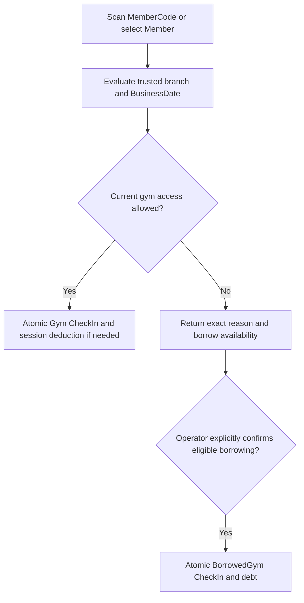

# Check-In / Access Management

Implemented on 2026-10-10. Check-In records actual entrance, using the existing
subscription lifecycle. It does not record Private sessions, Classes or Activities.
Controllers delegate to `CheckInService`, which uses `ApplicationDbContext`, existing
permission/branch context, gym timezone, BusinessDay and AuditLogs.

## Identification and operational flow

A scanner/QR/barcode supplies the existing global `MemberCode` as text. There is no
hardware SDK or new identity format. Reception may select `MemberId` from authorized
lookup. Exactly one of MemberId/MemberCode is required; Scanner requires MemberCode.
The existing enum is **Scanner=0, Manual=1, Coach=2**; Coach is preserved but cannot
perform entrance through this workflow. Manual entry has the same rules as scanning.

Reception lookup reuses the Member search predicate for name, raw/normalized phone,
MemberCode and numeric ClientCode. ClientCode matches only within the visited branch;
it is never the global scanned identity. Results contain minimal identity/name/status,
registration branch and ClientCode only when local. Normal branch lookup is limited
to Members registered in its city or with a subscription snapshot in that city;
global-capability lookup may search more broadly. A selected identity still undergoes
full access evaluation. No phone/profile/ownership graph is returned.



Evaluation is read-only and requires `CheckIns.Create`. Creation re-evaluates under
transaction locks; a preview is not an authorization token or reserved session.
Clients cannot submit balances, BusinessDate, authoritative access results or a chosen
subscription. Business denials return HTTP 200 with `allowed=false`, an exact stable
reason and no CheckIn. Invalid requests return 400, authentication failure 401,
capability/scope failure 403, unknown selected branch 404, and concurrent conflicts 409.

## Branch, city and dates

CheckIn.BranchId always records the actual visited branch. Normal staff use their
trusted current operational branch; supplying another branch is forbidden. Explicit
branch selection requires existing `Branches.AccessAll` plus the workflow permission.
Home/registration branch, plan owning branch, subscription origin branch and Sales
ownership do not have to equal the visited branch and are never reassigned by entry.

Gym access uses subscription **CityId snapshot**, not current plan scope. A Tanta
entitlement permits appropriate active Tanta branches, and cannot enter Cairo.
Single-city access remains intentional. Sales ownership grants no entrance permission
or general cross-branch administration.

An open BusinessDay determines effective BusinessDate, including after midnight.
Without an open day, the configured gym-local calendar date is used through existing
`OperationAccess` timezone conventions. UTC date is not substituted. CheckIn preserves
actual UTC timestamp (`CheckedInAt`, exposed as `occurredAt`), effective BusinessDate,
optional BusinessDayId and actual BranchId. Impossible future open-day facts are
rejected. Existing subscription dates remain inclusive: start through end; an end
before BusinessDate is expired. Legacy entries use stored BusinessDate or their linked
BusinessDay; if neither exists, history leaves the date unknown instead of guessing.

## Authoritative access evaluation

The resolver reuses an assembly-internal projection of SubscriptionService effective
status and snapshots. It requires active Member/visited branch/city, one unambiguous
current entitlement, started dates, valid employment where applicable, correct access
city, no blocking freeze/cancellation/suspension and an operationally open branch.
Operational candidates are bounded; overlapping or excessive legacy candidates fail
closed. No manually maintained Active flag overrides authoritative date/state facts.

Stable gym reasons include `MemberNotFound`, `MemberInactive`, `NoGymEntitlement`,
`SubscriptionNotStarted`, `SubscriptionExpired`, `SubscriptionFrozen`,
`SubscriptionCancelled`, `SubscriptionSuspended`, `NoSessionsRemaining`,
`AccessCityMismatch`, `BranchClosed`, `BranchInactive`, `EmployeeEntitlementInactive`,
`AmbiguousEntitlement`, `BorrowLimitReached`, `BorrowCycleRenewed` and `BorrowNotEligible`.
A denied expired attempt can report borrow availability and used/remaining allowance.

An applicable BranchClosure (`AppliesToGym=true`) blocks physical entrance on its
inclusive dates even when ExtensionDays=0 / subscription compensation is disabled.
Owner compensation policy and operational closure are separate. No city-wide closure
inference is added. Branch locking coordinates closure declaration with entry.

A normal freeze denies gym/borrowed access. Medical/custom extensions retain their
existing distinct semantics. Future/Scheduled subscriptions grant nothing before
StartDate and become usable through derived status on their effective start date;
there is no scheduler or activation job. Existing extension shifts remain intact.

## Unlimited, SessionBased, Employee and Freelance

Unlimited records every real entry without session deduction; RemainingSessions stays
null. SessionBased requires RemainingSessions > 0 and a valid date period. Each
successful Gym entry decrements exactly one and increments the subscription technical
Version in the same transaction as CheckIn/audit insertion. Date expiry denies normal
entry even with unused sessions, and preserves that historical unused balance.
Zero sessions before date expiry deny access and do not qualify for borrowing.

Every actual entry counts. Morning and evening visits with different OperationIds
create two rows and deduct two SessionBased sessions. A previous same-day entry never
blocks another legitimate entry. There is no one-session-per-day rule.

Active employment-bound Employee entitlement grants Unlimited access with no fake end
or sessions. Normal employee branch transfer retains entitlement; inactive employment
blocks access, and existing employee status/period history remains authoritative.
Freelance gym entitlement uses its snapshot mode/city/status like other customer
entitlements. Neither flow creates Finance or changes Sales/House assignment.

## Idempotency and transactions

Every creation/redemption requires a nonempty Guid OperationId. A successful entry is
unique by OperationId across CheckIns. An identical retry returns the original stored
entry and session before/after snapshots, even after another entry or date expiry.
Borrowed-entry results report the remaining cycle allowance; retries refresh borrowing
availability while preserving the original entry. Identity, actor, method, branch and borrow intent must match; an operation cannot be
rebound. Denials create no record or reserved operation. A changed intention needs a
new operation identity. Two distinct real operations remain distinct visits.

PostgreSQL transaction/savepoint and Member/subscription row locks serialize entrance,
renewal, freeze and debt mutation using existing conventions. Session deduction,
entry, debt/benefit use and audits commit together; failure rolls all back. Concurrent
final-session requests yield exactly one normal winner and never a negative balance.
Unique constraints handle cross-identity operation collisions; API conflicts are 409.
Managed CheckIns are append-only through EF. Existing nullable legacy fields and
Activity/Class/Coach enum values are retained for compatibility.

## Borrowed gym sessions and renewal settlement

Borrowing requires a date-expired **customer** cycle, active Member, eligible snapshot
city/branch, no operational closure or freeze, and explicit `confirmBorrow=true`.
A normal expired scan never silently creates debt. Employee, cancelled/suspended,
frozen, exhausted-but-unexpired or ambiguous entitlements cannot borrow.

Maximum **two entries per specific expired MemberSubscription cycle**, counting its
historical loans even after settlement. The legacy branch MaxBorrowedGymSessions field
is retained for compatibility; this workflow enforces the confirmed fixed limit of two.
The latest applicable expired cycle is used;
old renewed/settled cycles cannot be reopened. BorrowedGym is explicit CheckInType,
with an existing BorrowedGymSession debt row linked to CheckIn, source expired
subscription, Member, actual branch and timestamp. Borrowing changes only the technical
Version for concurrency, never expiry, subscription status, unused sessions, benefits,
ownership or money. Two requests cannot take the same final borrow slot.

Protected internal customer renewal and grant creation settle all outstanding Member
borrowed debt transactionally, preventing an activation bypass:

- New SessionBased grant 12, outstanding debt 2: RemainingSessions contribution 10;
  all debt becomes Settled. The historical PurchasedSessions remains 12.
- Unlimited renewal: all debt becomes Settled with no quantity deduction.
- New SessionBased grant smaller than debt (1 versus 2): reject the entire renewal;
  no partial settlement, negative balance or debt forgiveness.
- A new grant exactly equal to debt has zero available sessions; it still cannot
  borrow while its date period is unexpired.

Debt history preserves each borrowed entry/source cycle and exact settling
MembershipSubscriptionTransaction, settling entitlement and timestamp. Retry settles
nothing twice. Active same-mode carry-over remains remaining sessions plus newly
available grant contribution; expired unused sessions never carry. When the new
subscription later expires, it is a new cycle with its own two-entry allowance.

Future standalone single-session/visitor purchase is a distinct Finance integration:
it may pay for that visit without settling old debt or resetting borrowing. It is not
implemented here, and no PlanType/schema concept was added for it. Paid subscription
creation/renewal still have no public HTTP route until Sales/Payments exists.

## Trial / Invitation redemption

Redemption uses an **existing issued GuestInvitation Id plus matching phone** at its
issuing branch. Both Gym and Member sources are supported; Member source must retain
its existing inviter. There is no new guest token, issuance service, mobile Member
registration or automatic expiry duration. Stored Available is required; stored
Cancelled/Expired are denied. Gym/Member invitations without benefit linkage consume
only their one-time issued access.

PhoneNormalizer uses configured branch calling code; canonical phone and known Member
identity are matched through shared PhoneIdentity. Mismatched/changed linked identities
require reconciliation and are denied. Inactive known Members and closed/inactive
branches cannot redeem. A known matching Member may be linked atomically; no Member
is registered and no home branch/ownership is changed.

One redeemed trial per canonical phone and known Member is protected by existing
unique indexes/immutable redeemed history, phone identity lock, sorted Member locks
and invitation row lock. Equivalent phone spelling cannot obtain another trial.
The backend cannot identify a human using unrelated unlinked phone identities; no
new identity-verification product is claimed.

Confirmed benefit-linked rule: consume **one GUEST quantity snapshot unit at
redemption**. The exact benefit grant must belong to the inviting Member, have
BenefitCodeSnapshot=GUEST and Quantity type, and have an unused granted unit after
existing MemberBenefitUsages. Current plan/catalog edits do not change that allocation.
Invitation availability remains the issued access state; no new issuance-expiry rule
is invented. MemberBenefitUsage, redeemed invitation, Trial CheckIn and audit commit
atomically. A final benefit unit cannot serve two invitations. Usage is append-only;
its notes and TrialCheckIn audit link the invitation/use/entry. Trial never consumes
paid gym sessions or creates Sales/Payments. It does not count as a Gym/BorrowedGym
entrance for the future Private Training helper.

Additional reasons: `InvitationNotFound`, `InvitationUnavailable`,
`InvitationBranchMismatch`, `InvitationIdentityMismatch`, `TrialAlreadyUsed`,
`InvitationBenefitInvalid`, `InvitationBenefitExhausted`.

## API, permissions and operational queries

| Method | Route | Permission | Purpose |
|---|---|---|---|
| POST | /api/check-ins/evaluate | CheckIns.Create | Read-only gym access and borrowing preview |
| POST | /api/check-ins | CheckIns.Create | Atomic scanner/manual Gym or confirmed BorrowedGym entry |
| GET | /api/check-ins/members | CheckIns.Create | Minimal paginated Reception identification |
| GET | /api/check-ins | CheckIns.View | Scoped paginated entry history |
| GET | /api/members/{memberId}/check-ins/current-business-day | CheckIns.View | Selected-branch operational day history |
| GET | /api/members/{memberId}/borrowed-gym-sessions | CheckIns.View | Scoped paginated loan/settlement history |
| POST | /api/check-ins/trials | CheckIns.Create | Redeem existing issued one-time invitation |

Create JSON examples (new OperationId for each real operation):

```json
{"operationId":"<guid>","method":0,"memberCode":"<global MemberCode>"}
```

```json
{"operationId":"<guid>","method":1,"memberId":"<guid>","confirmBorrow":true}
```

```json
{"operationId":"<guid>","invitationId":"<issued guid>","phone":"<matching phone>"}
```

History filters: memberId, optional authorized branchId, from/to inclusive BusinessDate,
type, method, page/pageSize (1–100, default 25). Global users can view all branches
unless filtered; ordinary users view their current branch. Debt history additionally
filters expiredSubscriptionId. No unbounded history graph is returned.

BLL methods: EvaluateAsync, CreateAsync, FindMembersAsync, GetHistoryAsync,
GetCurrentBusinessDayAsync, GetCurrentGymEntryAsync, GetBorrowedDebtHistoryAsync,
RedeemTrialAsync. `GetCurrentGymEntryAsync` is an authorized operational lookup.
Assembly-internal `FindGymEntryAsync(memberId,branchId,businessDate)` supports future
Private services after their own workflow authorization. It returns the latest Gym or
BorrowedGym entrance, excluding Trial/Class/Activity. It proves entrance only; Private
entitlement, Coach permission and Private consumption still require later validation.

Permission catalog setup is explicit, never a startup seed:

```sh
dotnet run --project CampionsSystem.API -- --configure-checkin-permissions
```

The CLI requires Development and localhost. Default setup adds only missing
CheckIns.View/Create catalog entries, preserving inactive entries, role grants and
direct overrides. Optional CheckIns:ManagementRoleId must already have active global
branch capability. Existing staff grants are assigned through established management.
Demo bootstrap templates grant these capabilities to newly created Reception and
BranchManager roles; existing customized roles are preserved. Runtime authorization
never uses hardcoded role names.

## Audit, persistence and validation

AuditLogs events: CheckIn.Created, CheckIn.Borrowed, BorrowedSessionDebt.Created,
BorrowedSessionDebt.Settled, TrialCheckIn.Created. They retain actor, branch, entity,
Member/issued invitation, BusinessDate, type/method/operation and relevant session,
source debt or settling grant facts. Catalog setup uses Permission.CheckInAccessConfigured.
No duplicate audit system is introduced.

Reused: CheckIn/types/methods, Member/identifiers, MemberSubscription and grant/benefit
snapshots, BorrowedGymSession, GuestInvitation, MemberBenefitUsage, BusinessDay,
BranchClosure, GymBranch/City, AuditLogs and authorization context.

Migration `20261009200017_PrepareOperationalCheckIns` adds nullable legacy-compatible
OperationId/BusinessDate/SessionsBefore/SessionsAfter and debt SettledByTransactionId.
It adds unique operation/borrowed CheckIn links, operational and debt status indexes,
operational-date/session-delta/settlement checks and Restrict settling-grant FK.
Existing migrations were not changed. Reviewed SQL is in
[PrepareOperationalCheckIns.sql](database/PrepareOperationalCheckIns.sql).
Only the verified localhost development gym DB was migrated; production is untouched.

Tests cover access reasons, dates/overnight day, snapshot city/branch, Employee/Freelance,
multiple real entries, idempotent retries, rollback, independent PostgreSQL final
session/borrow/renewal/Trial/benefit races, debt settlement/full rejection, scoped
history/search and HTTP permissions/mass-assignment protection. Full existing feature
regressions and EF drift were verified at the final checkpoint.

Final validation on 2026-10-10: solution build zero warnings/errors; full suite **565
passed, zero failed/skipped** (76 additional cases relative to the 489-test subscription
checkpoint). EF model drift clean. Read-only development verification confirmed the
migration, five nullable additions, 19 CheckIn/debt indexes and 26 validated
constraints/FKs, both active permission catalog entries without inferred role grants,
and zero operational/debt/invitation/usage rows. Production untouched. An older migration
test was corrected to query its historical schema shape; legacy upgrade preservation
and later guest-registration retries now have regression coverage.

## Deferred integrations and offline readiness

GUID record/operation identities, append-only history, explicit visited branch,
actual timestamp, effective BusinessDate and deterministic atomic transactions form
an offline-ready foundation. No SyncOutbox, replication, conflict queue, cloud/local
routing or offline synchronization is implemented.

Sales/Payments, standalone visitor purchases, installments/refunds, commissions,
payroll, PrivateSession consumption, Classes/Activity attendance, Member branch
financial settlement, Coach mobile registration, frontend and messaging remain outside
this feature. Existing enum/schema compatibility does not enable those workflows.
