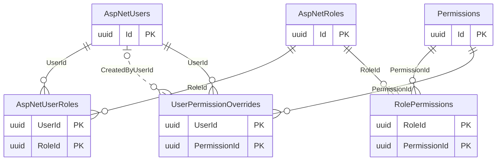
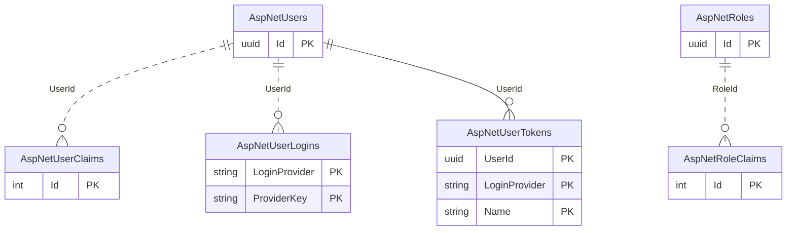
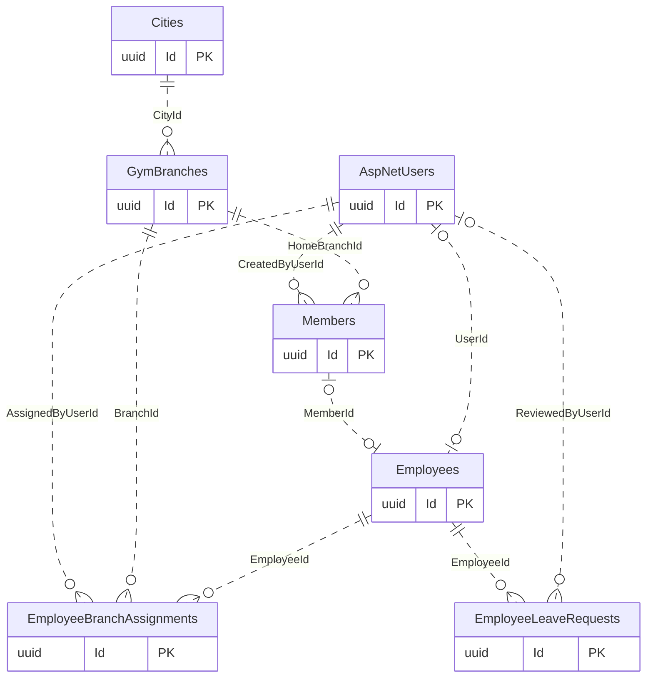

# Authentication, Employees and Branches

[Navigation](README.md) · [All tables](TABLE_INVENTORY.md) · [Review flags](REVIEW_FLAGS.md)

**15 tables.** An account is a login identity; an employee is a person employed by the gym. Their optional unique link allows employees without logins and an Owner without an employee. Multiple roles attach to the same account. Permissions describe actions; dated assignments and effective branch scope describe where actions are allowed.

## Read the diagrams

Only the relationships needed to understand this module are shown. Repeated boundary
boxes belong to other modules and are not counted twice. Routine authorizer/creator
FKs are usually omitted from diagrams; the table cards below list all actual FKs.
Use the [legend](OVERVIEW.md) for optional and one-to-many symbols.

### Capabilities and roles

### Identity framework details

### Employees and branch assignments

## Table details

Required/optional means SQL FK nullability, not unconditional permission to omit the
field from an API request; CHECK constraints and services can impose stricter rules.
The category describes its responsibility; history/evidence does not by itself
mean every column is immutable. Exact columns, CHECK SQL and indexes are in [schema.json](schema.json).

### AspNetUsers

Stores login accounts and their Identity security settings.

- **Kind:** Framework / core identity.
- **PK:** `Id` (uuid).
- **FKs:** none.
- **Unique indexes:** `NormalizedUserName`.
- **Sources:** [ApplicationUser.cs](../../CampionsSystem.DAL/Entities/ApplicationUser.cs).

### AspNetRoles

Stores the existing Identity role names.

- **Kind:** Framework / configuration.
- **PK:** `Id` (uuid).
- **FKs:** none.
- **Unique indexes:** `NormalizedName`.
- **Source:** inherited Identity mapping in [ApplicationDbContext](../../CampionsSystem.DAL/Data/ApplicationDbContext.cs) and [snapshot](../../CampionsSystem.DAL/Migrations/ApplicationDbContextModelSnapshot.cs).

### AspNetUserRoles

Links accounts to their assigned roles.

- **Kind:** Framework / junction.
- **PK:** `UserId` (uuid), `RoleId` (uuid).
- **FKs:**
  - `RoleId` → [AspNetRoles](01-auth-employees-branches.md#aspnetroles).`Id` (required, many children per parent, delete Cascade).
  - `UserId` → [AspNetUsers](01-auth-employees-branches.md#aspnetusers).`Id` (required, many children per parent, delete Cascade).
- **Source:** inherited Identity mapping in [ApplicationDbContext](../../CampionsSystem.DAL/Data/ApplicationDbContext.cs) and [snapshot](../../CampionsSystem.DAL/Migrations/ApplicationDbContextModelSnapshot.cs).

### AspNetUserClaims

Stores individual Identity claims for accounts.

- **Kind:** Framework.
- **PK:** `Id` (integer).
- **FKs:**
  - `UserId` → [AspNetUsers](01-auth-employees-branches.md#aspnetusers).`Id` (required, many children per parent, delete Cascade).
- **Source:** inherited Identity mapping in [ApplicationDbContext](../../CampionsSystem.DAL/Data/ApplicationDbContext.cs) and [snapshot](../../CampionsSystem.DAL/Migrations/ApplicationDbContextModelSnapshot.cs).

### AspNetRoleClaims

Stores Identity claims associated with roles.

- **Kind:** Framework.
- **PK:** `Id` (integer).
- **FKs:**
  - `RoleId` → [AspNetRoles](01-auth-employees-branches.md#aspnetroles).`Id` (required, many children per parent, delete Cascade).
- **Source:** inherited Identity mapping in [ApplicationDbContext](../../CampionsSystem.DAL/Data/ApplicationDbContext.cs) and [snapshot](../../CampionsSystem.DAL/Migrations/ApplicationDbContextModelSnapshot.cs).

### AspNetUserLogins

Stores external login provider identities linked to accounts.

- **Kind:** Framework / junction.
- **PK:** `LoginProvider` (text), `ProviderKey` (text).
- **FKs:**
  - `UserId` → [AspNetUsers](01-auth-employees-branches.md#aspnetusers).`Id` (required, many children per parent, delete Cascade).
- **Source:** inherited Identity mapping in [ApplicationDbContext](../../CampionsSystem.DAL/Data/ApplicationDbContext.cs) and [snapshot](../../CampionsSystem.DAL/Migrations/ApplicationDbContextModelSnapshot.cs).

### AspNetUserTokens

Stores Identity provider tokens associated with accounts.

- **Kind:** Framework.
- **PK:** `UserId` (uuid), `LoginProvider` (text), `Name` (text).
- **FKs:**
  - `UserId` → [AspNetUsers](01-auth-employees-branches.md#aspnetusers).`Id` (required, many children per parent, delete Cascade).
- **Source:** inherited Identity mapping in [ApplicationDbContext](../../CampionsSystem.DAL/Data/ApplicationDbContext.cs) and [snapshot](../../CampionsSystem.DAL/Migrations/ApplicationDbContextModelSnapshot.cs).

### Permissions

Stores the canonical capability codes, titles, modules and active flags.

- **Kind:** Configuration.
- **PK:** `Id` (uuid).
- **FKs:** none.
- **Unique indexes:** `Code`.
- **Sources:** [Permission.cs](../../CampionsSystem.DAL/Entities/Permission.cs), [PermissionConfiguration.cs](../../CampionsSystem.DAL/Configurations/PermissionConfiguration.cs).

### RolePermissions

Links existing roles to their granted capabilities.

- **Kind:** Configuration / junction.
- **PK:** `RoleId` (uuid), `PermissionId` (uuid).
- **FKs:**
  - `PermissionId` → [Permissions](01-auth-employees-branches.md#permissions).`Id` (required, many children per parent, delete Restrict).
  - `RoleId` → [AspNetRoles](01-auth-employees-branches.md#aspnetroles).`Id` (required, many children per parent, delete Restrict).
- **Sources:** [RolePermission.cs](../../CampionsSystem.DAL/Entities/RolePermission.cs), [RolePermissionConfiguration.cs](../../CampionsSystem.DAL/Configurations/RolePermissionConfiguration.cs).

### UserPermissionOverrides

Stores one direct Allow or Deny decision per account and capability.

- **Kind:** Configuration / junction.
- **PK:** `UserId` (uuid), `PermissionId` (uuid).
- **FKs:**
  - `CreatedByUserId` → [AspNetUsers](01-auth-employees-branches.md#aspnetusers).`Id` (optional, many children per parent, delete Restrict).
  - `PermissionId` → [Permissions](01-auth-employees-branches.md#permissions).`Id` (required, many children per parent, delete Restrict).
  - `UserId` → [AspNetUsers](01-auth-employees-branches.md#aspnetusers).`Id` (required, many children per parent, delete Restrict).
- **Sources:** [UserPermissionOverride.cs](../../CampionsSystem.DAL/Entities/UserPermissionOverride.cs), [UserPermissionOverrideConfiguration.cs](../../CampionsSystem.DAL/Configurations/UserPermissionOverrideConfiguration.cs).

### Cities

Stores the cities used by branches and plans.

- **Kind:** Configuration.
- **PK:** `Id` (uuid).
- **FKs:** none.
- **Sources:** [City.cs](../../CampionsSystem.DAL/Entities/City.cs), [CityConfiguration.cs](../../CampionsSystem.DAL/Configurations/CityConfiguration.cs).

### GymBranches

Stores each gym branch and its operational settings.

- **Kind:** Core.
- **PK:** `Id` (uuid).
- **FKs:**
  - `CityId` → [Cities](01-auth-employees-branches.md#cities).`Id` (required, many children per parent, delete Restrict).
- **Sources:** [GymBranch.cs](../../CampionsSystem.DAL/Entities/GymBranch.cs), [GymBranchConfiguration.cs](../../CampionsSystem.DAL/Configurations/GymBranchConfiguration.cs).

### Employees

Stores employee profiles, employment status and optional account/member links.

- **Kind:** Core.
- **PK:** `Id` (uuid).
- **FKs:**
  - `MemberId` → [Members](02-members-crm.md#members).`Id` (optional, at most one child per parent, delete Restrict).
  - `UserId` → [AspNetUsers](01-auth-employees-branches.md#aspnetusers).`Id` (optional, at most one child per parent, delete Restrict).
- **Unique indexes:** `MemberId`; `UserId`.
- **Sources:** [Employee.cs](../../CampionsSystem.DAL/Entities/Employee.cs), [EmployeeConfiguration.cs](../../CampionsSystem.DAL/Configurations/EmployeeConfiguration.cs).

### EmployeeBranchAssignments

Stores dated employee assignments and transfers between branches.

- **Kind:** History / junction.
- **PK:** `Id` (uuid).
- **FKs:**
  - `AssignedByUserId` → [AspNetUsers](01-auth-employees-branches.md#aspnetusers).`Id` (required, many children per parent, delete Restrict).
  - `BranchId` → [GymBranches](01-auth-employees-branches.md#gymbranches).`Id` (required, many children per parent, delete Restrict).
  - `EmployeeId` → [Employees](01-auth-employees-branches.md#employees).`Id` (required, many children per parent, delete Restrict).
- **Unique indexes:** `EmployeeId` where `"EndDate" IS NULL AND "IsPrimary"`.
- **Sources:** [EmployeeBranchAssignment.cs](../../CampionsSystem.DAL/Entities/EmployeeBranchAssignment.cs), [EmployeeBranchAssignmentConfiguration.cs](../../CampionsSystem.DAL/Configurations/EmployeeBranchAssignmentConfiguration.cs).

### EmployeeLeaveRequests

Stores employee leave requests and their review decisions.

- **Kind:** Core / history.
- **PK:** `Id` (uuid).
- **FKs:**
  - `EmployeeId` → [Employees](01-auth-employees-branches.md#employees).`Id` (required, many children per parent, delete Restrict).
  - `ReviewedByUserId` → [AspNetUsers](01-auth-employees-branches.md#aspnetusers).`Id` (optional, many children per parent, delete Restrict).
- **Sources:** [EmployeeLeaveRequest.cs](../../CampionsSystem.DAL/Entities/EmployeeLeaveRequest.cs), [EmployeeLeaveRequestConfiguration.cs](../../CampionsSystem.DAL/Configurations/EmployeeLeaveRequestConfiguration.cs).

