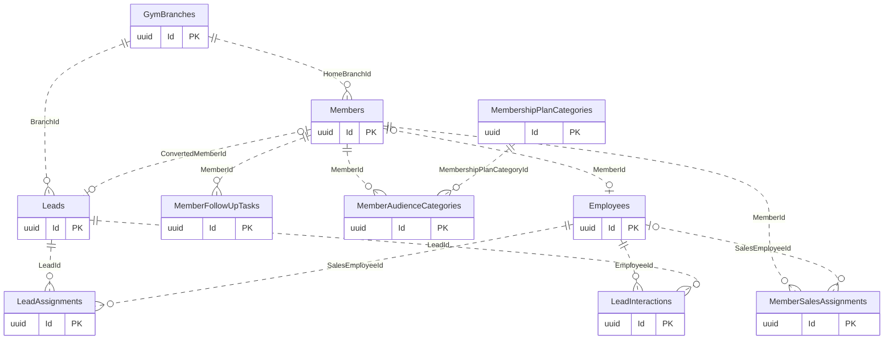

# Members and CRM

[Navigation](README.md) · [All tables](TABLE_INVENTORY.md) · [Review flags](REVIEW_FLAGS.md)

**7 tables.** A Member is a registered customer; a Lead is a prospect. Sales ownership is recorded as dated assignments, separately from the person creating a sale or collecting money. House assignments have no Sales employee. Follow-ups and audience membership are separate facts.

## Read the diagrams

Only the relationships needed to understand this module are shown. Repeated boundary
boxes belong to other modules and are not counted twice. Routine authorizer/creator
FKs are usually omitted from diagrams; the table cards below list all actual FKs.
Use the [legend](OVERVIEW.md) for optional and one-to-many symbols.

### Contacts and commercial ownership

## Table details

Required/optional means SQL FK nullability, not unconditional permission to omit the
field from an API request; CHECK constraints and services can impose stricter rules.
The category describes its responsibility; history/evidence does not by itself
mean every column is immutable. Exact columns, CHECK SQL and indexes are in [schema.json](schema.json).

### Members

Stores registered members, contact details, branch and member codes.

- **Kind:** Core.
- **PK:** `Id` (uuid).
- **FKs:**
  - `CreatedByUserId` → [AspNetUsers](01-auth-employees-branches.md#aspnetusers).`Id` (required, many children per parent, delete Restrict).
  - `HomeBranchId` → [GymBranches](01-auth-employees-branches.md#gymbranches).`Id` (required, many children per parent, delete Restrict).
- **Unique indexes:** `MemberCode`; `PrimaryPhoneNormalized` where `"PrimaryPhoneNormalized" IS NOT NULL`; `HomeBranchId, ClientCode` where `"ClientCode" IS NOT NULL`.
- **Sources:** [Member.cs](../../CampionsSystem.DAL/Entities/Member.cs), [MemberConfiguration.cs](../../CampionsSystem.DAL/Configurations/MemberConfiguration.cs).

### MemberSalesAssignments

Stores dated member ownership by a Sales employee or House.

- **Kind:** History / junction.
- **PK:** `Id` (uuid).
- **FKs:**
  - `AssignedByUserId` → [AspNetUsers](01-auth-employees-branches.md#aspnetusers).`Id` (required, many children per parent, delete Restrict).
  - `MemberId` → [Members](02-members-crm.md#members).`Id` (required, many children per parent, delete Restrict).
  - `SalesEmployeeId` → [Employees](01-auth-employees-branches.md#employees).`Id` (optional, many children per parent, delete Restrict).
- **Unique indexes:** `MemberId` where `"EndedAt" IS NULL`.
- **Sources:** [MemberSalesAssignment.cs](../../CampionsSystem.DAL/Entities/MemberSalesAssignment.cs), [MemberSalesAssignmentConfiguration.cs](../../CampionsSystem.DAL/Configurations/MemberSalesAssignmentConfiguration.cs).

### MemberFollowUpTasks

Stores member follow-up tasks, responsible employees and completion facts.

- **Kind:** Core / history.
- **PK:** `Id` (uuid).
- **FKs:**
  - `CompletedByUserId` → [AspNetUsers](01-auth-employees-branches.md#aspnetusers).`Id` (optional, many children per parent, delete Restrict).
  - `CreatedByUserId` → [AspNetUsers](01-auth-employees-branches.md#aspnetusers).`Id` (optional, many children per parent, delete Restrict).
  - `MemberId` → [Members](02-members-crm.md#members).`Id` (required, many children per parent, delete Restrict).
- **Unique indexes:** `MemberId, Reason` where `"CompletedAt" IS NULL`.
- **Sources:** [MemberFollowUpTask.cs](../../CampionsSystem.DAL/Entities/MemberFollowUpTask.cs), [MemberFollowUpTaskConfiguration.cs](../../CampionsSystem.DAL/Configurations/MemberFollowUpTaskConfiguration.cs).

### MemberAudienceCategories

Stores dated member eligibility categories used by offers.

- **Kind:** History / junction.
- **PK:** `Id` (uuid).
- **FKs:**
  - `AssignedByUserId` → [AspNetUsers](01-auth-employees-branches.md#aspnetusers).`Id` (required, many children per parent, delete Restrict).
  - `MemberId` → [Members](02-members-crm.md#members).`Id` (required, many children per parent, delete Restrict).
  - `MembershipPlanCategoryId` → [MembershipPlanCategories](03-subscriptions-check-in.md#membershipplancategories).`Id` (required, many children per parent, delete Restrict).
- **Unique indexes:** `MemberId, MembershipPlanCategoryId` where `"EndedAt" IS NULL`.
- **Sources:** [MemberAudienceCategory.cs](../../CampionsSystem.DAL/Entities/MemberAudienceCategory.cs), [MemberAudienceCategoryConfiguration.cs](../../CampionsSystem.DAL/Configurations/MemberAudienceCategoryConfiguration.cs).

### Leads

Stores prospective customers and their conversion or loss details.

- **Kind:** Core.
- **PK:** `Id` (uuid).
- **FKs:**
  - `BranchId` → [GymBranches](01-auth-employees-branches.md#gymbranches).`Id` (required, many children per parent, delete Restrict).
  - `ConvertedMemberId` → [Members](02-members-crm.md#members).`Id` (optional, at most one child per parent, delete Restrict).
  - `CreatedByUserId` → [AspNetUsers](01-auth-employees-branches.md#aspnetusers).`Id` (required, many children per parent, delete Restrict).
- **Unique indexes:** `ConvertedMemberId` where `"ConvertedMemberId" IS NOT NULL`; `PhoneNormalized` where `"PhoneNormalized" IS NOT NULL`.
- **Sources:** [Lead.cs](../../CampionsSystem.DAL/Entities/Lead.cs), [LeadConfiguration.cs](../../CampionsSystem.DAL/Configurations/LeadConfiguration.cs).

### LeadAssignments

Stores dated Sales employee ownership of leads.

- **Kind:** History / junction.
- **PK:** `Id` (uuid).
- **FKs:**
  - `AssignedByUserId` → [AspNetUsers](01-auth-employees-branches.md#aspnetusers).`Id` (required, many children per parent, delete Restrict).
  - `LeadId` → [Leads](02-members-crm.md#leads).`Id` (required, many children per parent, delete Restrict).
  - `SalesEmployeeId` → [Employees](01-auth-employees-branches.md#employees).`Id` (required, many children per parent, delete Restrict).
- **Unique indexes:** `LeadId` where `"EndedAt" IS NULL`.
- **Sources:** [LeadAssignment.cs](../../CampionsSystem.DAL/Entities/LeadAssignment.cs), [LeadAssignmentConfiguration.cs](../../CampionsSystem.DAL/Configurations/LeadAssignmentConfiguration.cs).

### LeadInteractions

Stores recorded lead contacts, outcomes and next follow-up dates.

- **Kind:** History.
- **PK:** `Id` (uuid).
- **FKs:**
  - `CreatedByUserId` → [AspNetUsers](01-auth-employees-branches.md#aspnetusers).`Id` (optional, many children per parent, delete Restrict).
  - `EmployeeId` → [Employees](01-auth-employees-branches.md#employees).`Id` (required, many children per parent, delete Restrict).
  - `LeadId` → [Leads](02-members-crm.md#leads).`Id` (required, many children per parent, delete Restrict).
- **Sources:** [LeadInteraction.cs](../../CampionsSystem.DAL/Entities/LeadInteraction.cs), [LeadInteractionConfiguration.cs](../../CampionsSystem.DAL/Configurations/LeadInteractionConfiguration.cs).

