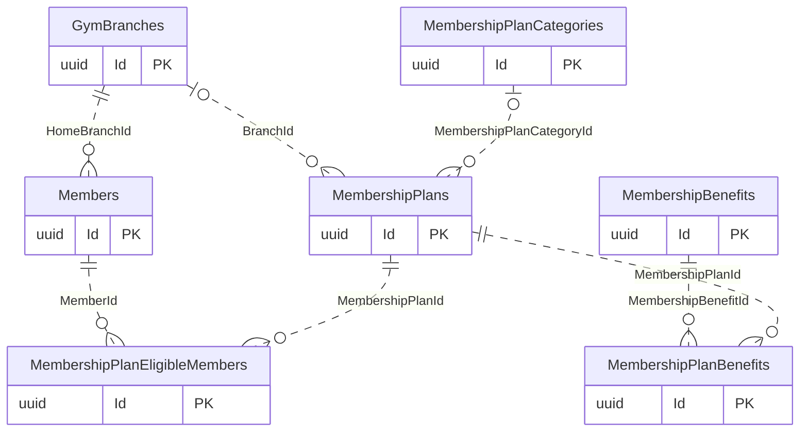
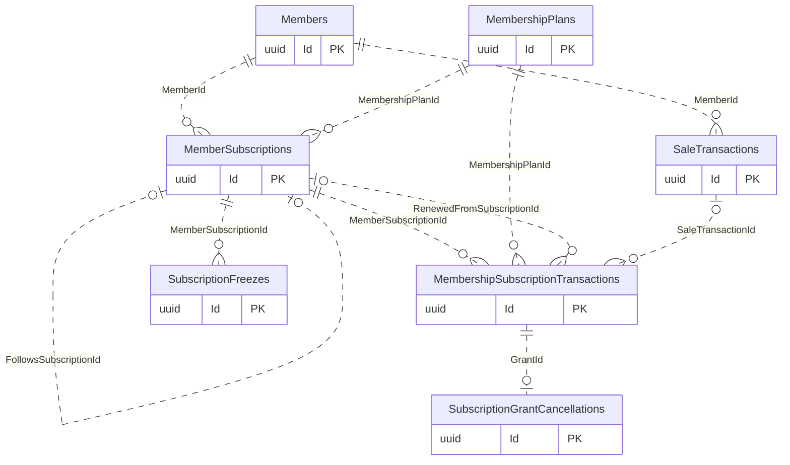
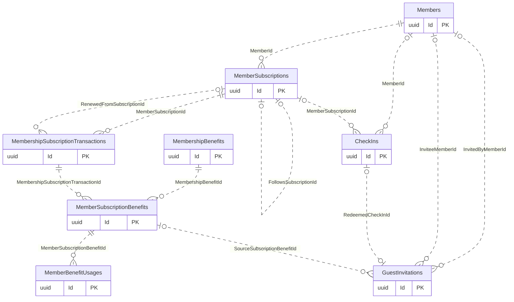
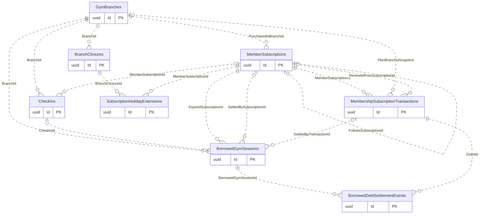

# Subscriptions and Check-In

[Navigation](README.md) · [All tables](TABLE_INVENTORY.md) · [Review flags](REVIEW_FLAGS.md)

**17 tables.** Plans are editable configuration; subscription/grant snapshots record what a member purchased. CheckIns is a shared attendance table for gym, activity, class and trial entry, not only reception entry. Private delivery is a separate PrivateSessions record. FK nullability here also covers legitimate type alternatives and legacy history.

## Read the diagrams

Only the relationships needed to understand this module are shown. Repeated boundary
boxes belong to other modules and are not counted twice. Routine authorizer/creator
FKs are usually omitted from diagrams; the table cards below list all actual FKs.
Use the [legend](OVERVIEW.md) for optional and one-to-many symbols.

### Plan configuration

### Entitlement and grant history

### Benefits, guests and attendance

### Borrowed entry and closure compensation

## Table details

Required/optional means SQL FK nullability, not unconditional permission to omit the
field from an API request; CHECK constraints and services can impose stricter rules.
The category describes its responsibility; history/evidence does not by itself
mean every column is immutable. Exact columns, CHECK SQL and indexes are in [schema.json](schema.json).

### MembershipPlans

Stores regular gym membership plan prices, durations and access rules.

- **Kind:** Configuration.
- **PK:** `Id` (uuid).
- **FKs:**
  - `BranchId` → [GymBranches](01-auth-employees-branches.md#gymbranches).`Id` (optional, many children per parent, delete Restrict).
  - `CityId` → [Cities](01-auth-employees-branches.md#cities).`Id` (required, many children per parent, delete Restrict).
  - `FreelanceCoachEmployeeId` → [Employees](01-auth-employees-branches.md#employees).`Id` (optional, many children per parent, delete Restrict).
  - `MembershipPlanCategoryId` → [MembershipPlanCategories](03-subscriptions-check-in.md#membershipplancategories).`Id` (optional, many children per parent, delete Restrict).
- **Sources:** [MembershipPlan.cs](../../CampionsSystem.DAL/Entities/MembershipPlan.cs), [MembershipPlanConfiguration.cs](../../CampionsSystem.DAL/Configurations/MembershipPlanConfiguration.cs).

### MembershipPlanCategories

Stores named plan/member audience categories.

- **Kind:** Configuration.
- **PK:** `Id` (uuid).
- **FKs:** none.
- **Unique indexes:** `Name`.
- **Sources:** [MembershipPlanCategory.cs](../../CampionsSystem.DAL/Entities/MembershipPlanCategory.cs), [MembershipPlanCategoryConfiguration.cs](../../CampionsSystem.DAL/Configurations/MembershipPlanCategoryConfiguration.cs).

### MembershipPlanEligibleMembers

Links restricted membership plans to eligible members.

- **Kind:** Configuration / junction.
- **PK:** `Id` (uuid).
- **FKs:**
  - `CreatedByUserId` → [AspNetUsers](01-auth-employees-branches.md#aspnetusers).`Id` (required, many children per parent, delete Restrict).
  - `MemberId` → [Members](02-members-crm.md#members).`Id` (required, many children per parent, delete Restrict).
  - `MembershipPlanId` → [MembershipPlans](03-subscriptions-check-in.md#membershipplans).`Id` (required, many children per parent, delete Restrict).
- **Unique indexes:** `MembershipPlanId, MemberId`.
- **Sources:** [MembershipPlanEligibleMember.cs](../../CampionsSystem.DAL/Entities/MembershipPlanEligibleMember.cs), [MembershipPlanEligibleMemberConfiguration.cs](../../CampionsSystem.DAL/Configurations/MembershipPlanEligibleMemberConfiguration.cs).

### MembershipBenefits

Stores reusable membership benefit definitions.

- **Kind:** Configuration.
- **PK:** `Id` (uuid).
- **FKs:** none.
- **Unique indexes:** `Code`; `Name`.
- **Sources:** [MembershipBenefit.cs](../../CampionsSystem.DAL/Entities/MembershipBenefit.cs), [MembershipBenefitConfiguration.cs](../../CampionsSystem.DAL/Configurations/MembershipBenefitConfiguration.cs).

### MembershipPlanBenefits

Links membership plans to their configured benefit grants.

- **Kind:** Configuration / junction.
- **PK:** `Id` (uuid).
- **FKs:**
  - `MembershipBenefitId` → [MembershipBenefits](03-subscriptions-check-in.md#membershipbenefits).`Id` (required, many children per parent, delete Restrict).
  - `MembershipPlanId` → [MembershipPlans](03-subscriptions-check-in.md#membershipplans).`Id` (required, many children per parent, delete Restrict).
- **Unique indexes:** `MembershipPlanId, MembershipBenefitId`.
- **Sources:** [MembershipPlanBenefit.cs](../../CampionsSystem.DAL/Entities/MembershipPlanBenefit.cs), [MembershipPlanBenefitConfiguration.cs](../../CampionsSystem.DAL/Configurations/MembershipPlanBenefitConfiguration.cs).

### MemberSubscriptions

Stores a member's regular gym entitlement, dates and session balance.

- **Kind:** Core.
- **PK:** `Id` (uuid).
- **FKs:**
  - `CityId` → [Cities](01-auth-employees-branches.md#cities).`Id` (required, many children per parent, delete Restrict).
  - `EmployeeId` → [Employees](01-auth-employees-branches.md#employees).`Id` (optional, many children per parent, delete Restrict).
  - `FollowsSubscriptionId` → [MemberSubscriptions](03-subscriptions-check-in.md#membersubscriptions).`Id` (optional, at most one child per parent, delete Restrict).
  - `MemberId` → [Members](02-members-crm.md#members).`Id` (required, many children per parent, delete Restrict).
  - `MembershipPlanId` → [MembershipPlans](03-subscriptions-check-in.md#membershipplans).`Id` (required, many children per parent, delete Restrict).
  - `PurchasedAtBranchId` → [GymBranches](01-auth-employees-branches.md#gymbranches).`Id` (required, many children per parent, delete Restrict).
- **Unique indexes:** `EmployeeId` where `"EmployeeId" IS NOT NULL AND "EndDate" IS NULL`; `FollowsSubscriptionId`; `MemberId, IX_MemberSubscriptions_OpenEmployeeMember` where `"EmployeeId" IS NOT NULL AND "EndDate" IS NULL`.
- **Sources:** [MemberSubscription.cs](../../CampionsSystem.DAL/Entities/MemberSubscription.cs), [MemberSubscriptionConfiguration.cs](../../CampionsSystem.DAL/Configurations/MemberSubscriptionConfiguration.cs).

### MembershipSubscriptionTransactions

Stores purchase or renewal grants with historical plan and price snapshots.

- **Kind:** History / evidence.
- **PK:** `Id` (uuid).
- **FKs:**
  - `BusinessDayId` → [BusinessDays](05-shifts-vault-expenses.md#businessdays).`Id` (optional, many children per parent, delete Restrict).
  - `CityIdSnapshot` → [Cities](01-auth-employees-branches.md#cities).`Id` (optional, many children per parent, delete Restrict).
  - `CreatedByUserId` → [AspNetUsers](01-auth-employees-branches.md#aspnetusers).`Id` (optional, many children per parent, delete Restrict).
  - `FreelanceCoachEmployeeIdSnapshot` → [Employees](01-auth-employees-branches.md#employees).`Id` (optional, many children per parent, delete Restrict).
  - `MemberSubscriptionId` → [MemberSubscriptions](03-subscriptions-check-in.md#membersubscriptions).`Id` (required, many children per parent, delete Restrict).
  - `MembershipPlanId` → [MembershipPlans](03-subscriptions-check-in.md#membershipplans).`Id` (required, many children per parent, delete Restrict).
  - `PlanBranchIdSnapshot` → [GymBranches](01-auth-employees-branches.md#gymbranches).`Id` (optional, many children per parent, delete Restrict).
  - `RenewedFromSubscriptionId` → [MemberSubscriptions](03-subscriptions-check-in.md#membersubscriptions).`Id` (optional, many children per parent, delete Restrict).
  - `SaleTransactionId` → [SaleTransactions](04-sales-payments.md#saletransactions).`Id` (optional, many children per parent, delete Restrict).
- **Unique indexes:** `OperationId`; `SaleTransactionId` where `"OperationId" IS NOT NULL`.
- **Sources:** [MembershipSubscriptionTransaction.cs](../../CampionsSystem.DAL/Entities/MembershipSubscriptionTransaction.cs), [MembershipSubscriptionTransactionConfiguration.cs](../../CampionsSystem.DAL/Configurations/MembershipSubscriptionTransactionConfiguration.cs).

### MemberSubscriptionBenefits

Stores the benefit quantities and descriptions granted to a subscription.

- **Kind:** Evidence.
- **PK:** `Id` (uuid).
- **FKs:**
  - `MembershipBenefitId` → [MembershipBenefits](03-subscriptions-check-in.md#membershipbenefits).`Id` (required, many children per parent, delete Restrict).
  - `MembershipSubscriptionTransactionId` → [MembershipSubscriptionTransactions](03-subscriptions-check-in.md#membershipsubscriptiontransactions).`Id` (required, many children per parent, delete Restrict).
- **Unique indexes:** `MembershipSubscriptionTransactionId, MembershipBenefitId`.
- **Sources:** [MemberSubscriptionBenefit.cs](../../CampionsSystem.DAL/Entities/MemberSubscriptionBenefit.cs), [MemberSubscriptionBenefitConfiguration.cs](../../CampionsSystem.DAL/Configurations/MemberSubscriptionBenefitConfiguration.cs).

### MemberBenefitUsages

Stores actual consumption of granted subscription benefits.

- **Kind:** History / evidence.
- **PK:** `Id` (uuid).
- **FKs:**
  - `BranchId` → [GymBranches](01-auth-employees-branches.md#gymbranches).`Id` (required, many children per parent, delete Restrict).
  - `CreatedByUserId` → [AspNetUsers](01-auth-employees-branches.md#aspnetusers).`Id` (optional, many children per parent, delete Restrict).
  - `MemberSubscriptionBenefitId` → [MemberSubscriptionBenefits](03-subscriptions-check-in.md#membersubscriptionbenefits).`Id` (required, many children per parent, delete Restrict).
- **Sources:** [MemberBenefitUsage.cs](../../CampionsSystem.DAL/Entities/MemberBenefitUsage.cs), [MemberBenefitUsageConfiguration.cs](../../CampionsSystem.DAL/Configurations/MemberBenefitUsageConfiguration.cs).

### SubscriptionFreezes

Stores subscription freezes and the extension days applied.

- **Kind:** History.
- **PK:** `Id` (uuid).
- **FKs:**
  - `ApprovedByUserId` → [AspNetUsers](01-auth-employees-branches.md#aspnetusers).`Id` (required, many children per parent, delete Restrict).
  - `CompletedByUserId` → [AspNetUsers](01-auth-employees-branches.md#aspnetusers).`Id` (optional, many children per parent, delete Restrict).
  - `MemberSubscriptionId` → [MemberSubscriptions](03-subscriptions-check-in.md#membersubscriptions).`Id` (required, many children per parent, delete Restrict).
- **Unique indexes:** `OperationId`.
- **Sources:** [SubscriptionFreeze.cs](../../CampionsSystem.DAL/Entities/SubscriptionFreeze.cs), [SubscriptionFreezeConfiguration.cs](../../CampionsSystem.DAL/Configurations/SubscriptionFreezeConfiguration.cs).

### SubscriptionHolidayExtensions

Stores closure-day compensation already applied to a subscription.

- **Kind:** Evidence.
- **PK:** `Id` (uuid).
- **FKs:**
  - `BranchClosureId` → [BranchClosures](03-subscriptions-check-in.md#branchclosures).`Id` (required, many children per parent, delete Restrict).
  - `CreatedByUserId` → [AspNetUsers](01-auth-employees-branches.md#aspnetusers).`Id` (required, many children per parent, delete Restrict).
  - `MemberSubscriptionId` → [MemberSubscriptions](03-subscriptions-check-in.md#membersubscriptions).`Id` (required, many children per parent, delete Restrict).
- **Unique indexes:** `MemberSubscriptionId, ProtectedDate`.
- **Sources:** [SubscriptionHolidayExtension.cs](../../CampionsSystem.DAL/Entities/SubscriptionHolidayExtension.cs), [SubscriptionHolidayExtensionConfiguration.cs](../../CampionsSystem.DAL/Configurations/SubscriptionHolidayExtensionConfiguration.cs).

### SubscriptionGrantCancellations

Stores reversals of sold subscription grants without erasing purchase history.

- **Kind:** Evidence.
- **PK:** `Id` (uuid).
- **FKs:**
  - `GrantId` → [MembershipSubscriptionTransactions](03-subscriptions-check-in.md#membershipsubscriptiontransactions).`Id` (required, at most one child per parent, delete Restrict).
  - `RefundId` → [Refunds](04-sales-payments.md#refunds).`Id` (required, at most one child per parent, delete Restrict).
- **Unique indexes:** `GrantId`; `RefundId`.
- **Sources:** [SubscriptionGrantCancellation.cs](../../CampionsSystem.DAL/Entities/SubscriptionGrantCancellation.cs), [SubscriptionGrantCancellationConfiguration.cs](../../CampionsSystem.DAL/Configurations/SubscriptionGrantCancellationConfiguration.cs).

### BorrowedGymSessions

Stores temporary gym entry debts and their settlement links.

- **Kind:** Core / history.
- **PK:** `Id` (uuid).
- **FKs:**
  - `BranchId` → [GymBranches](01-auth-employees-branches.md#gymbranches).`Id` (required, many children per parent, delete Restrict).
  - `CheckInId` → [CheckIns](03-subscriptions-check-in.md#checkins).`Id` (optional, at most one child per parent, delete Restrict).
  - `ExpiredSubscriptionId` → [MemberSubscriptions](03-subscriptions-check-in.md#membersubscriptions).`Id` (required, many children per parent, delete Restrict).
  - `MemberId` → [Members](02-members-crm.md#members).`Id` (required, many children per parent, delete Restrict).
  - `SettledBySubscriptionId` → [MemberSubscriptions](03-subscriptions-check-in.md#membersubscriptions).`Id` (optional, many children per parent, delete Restrict).
  - `SettledByTransactionId` → [MembershipSubscriptionTransactions](03-subscriptions-check-in.md#membershipsubscriptiontransactions).`Id` (optional, many children per parent, delete Restrict).
- **Unique indexes:** `CheckInId`.
- **Sources:** [BorrowedGymSession.cs](../../CampionsSystem.DAL/Entities/BorrowedGymSession.cs), [BorrowedGymSessionConfiguration.cs](../../CampionsSystem.DAL/Configurations/BorrowedGymSessionConfiguration.cs).

### BorrowedDebtSettlementEvents

Stores ordered settlement and reversal events for borrowed-session debts.

- **Kind:** History / evidence.
- **PK:** `Id` (uuid).
- **FKs:**
  - `ActorId` → [AspNetUsers](01-auth-employees-branches.md#aspnetusers).`Id` (required, many children per parent, delete Restrict).
  - `BorrowedGymSessionId` → [BorrowedGymSessions](03-subscriptions-check-in.md#borrowedgymsessions).`Id` (required, many children per parent, delete Restrict).
  - `GrantId` → [MembershipSubscriptionTransactions](03-subscriptions-check-in.md#membershipsubscriptiontransactions).`Id` (required, many children per parent, delete Restrict).
  - `RefundId` → [Refunds](04-sales-payments.md#refunds).`Id` (optional, many children per parent, delete Restrict).
- **Unique indexes:** `BorrowedGymSessionId, Sequence`.
- **Sources:** [BorrowedDebtSettlementEvent.cs](../../CampionsSystem.DAL/Entities/BorrowedDebtSettlementEvent.cs), [BorrowedDebtSettlementEventConfiguration.cs](../../CampionsSystem.DAL/Configurations/BorrowedDebtSettlementEventConfiguration.cs).

### GuestInvitations

Stores guest invitations, their source benefit and redemption status.

- **Kind:** Core / history.
- **PK:** `Id` (uuid).
- **FKs:**
  - `BranchId` → [GymBranches](01-auth-employees-branches.md#gymbranches).`Id` (required, many children per parent, delete Restrict).
  - `CreatedByUserId` → [AspNetUsers](01-auth-employees-branches.md#aspnetusers).`Id` (optional, many children per parent, delete Restrict).
  - `InvitedByMemberId` → [Members](02-members-crm.md#members).`Id` (optional, many children per parent, delete Restrict).
  - `InviteeMemberId` → [Members](02-members-crm.md#members).`Id` (optional, many children per parent, delete Restrict).
  - `RedeemedCheckInId` → [CheckIns](03-subscriptions-check-in.md#checkins).`Id` (optional, at most one child per parent, delete Restrict).
  - `SourceSubscriptionBenefitId` → [MemberSubscriptionBenefits](03-subscriptions-check-in.md#membersubscriptionbenefits).`Id` (optional, many children per parent, delete Restrict).
- **Unique indexes:** `InviteeMemberId` where `"Status" = 'Redeemed' AND "InviteeMemberId" IS NOT NULL`; `InviteePhoneNormalized` where `"Status" = 'Redeemed'`; `RedeemedCheckInId` where `"RedeemedCheckInId" IS NOT NULL`.
- **Sources:** [GuestInvitation.cs](../../CampionsSystem.DAL/Entities/GuestInvitation.cs), [GuestInvitationConfiguration.cs](../../CampionsSystem.DAL/Configurations/GuestInvitationConfiguration.cs).

### BranchClosures

Stores dated branch closures and entitlement compensation settings.

- **Kind:** Configuration / history.
- **PK:** `Id` (uuid).
- **FKs:**
  - `BranchId` → [GymBranches](01-auth-employees-branches.md#gymbranches).`Id` (required, many children per parent, delete Restrict).
  - `CreatedByUserId` → [AspNetUsers](01-auth-employees-branches.md#aspnetusers).`Id` (required, many children per parent, delete Restrict).
- **Sources:** [BranchClosure.cs](../../CampionsSystem.DAL/Entities/BranchClosure.cs), [BranchClosureConfiguration.cs](../../CampionsSystem.DAL/Configurations/BranchClosureConfiguration.cs).

### CheckIns

Stores gym, activity, class or trial attendance and session-consumption evidence.

- **Kind:** Core / evidence.
- **PK:** `Id` (uuid).
- **FKs:**
  - `ActivitySubscriptionId` → [ActivitySubscriptions](07-private-classes.md#activitysubscriptions).`Id` (optional, many children per parent, delete Restrict).
  - `BranchId` → [GymBranches](01-auth-employees-branches.md#gymbranches).`Id` (required, many children per parent, delete Restrict).
  - `BusinessDayId` → [BusinessDays](05-shifts-vault-expenses.md#businessdays).`Id` (optional, many children per parent, delete Restrict).
  - `ClassSessionId` → [ClassSessions](07-private-classes.md#classsessions).`Id` (optional, many children per parent, delete Restrict).
  - `ClassesSubscriptionId` → [ClassesSubscriptions](07-private-classes.md#classessubscriptions).`Id` (optional, many children per parent, delete Restrict).
  - `CoachEmployeeId` → [Employees](01-auth-employees-branches.md#employees).`Id` (optional, many children per parent, delete Restrict).
  - `CreatedByUserId` → [AspNetUsers](01-auth-employees-branches.md#aspnetusers).`Id` (required, many children per parent, delete Restrict).
  - `GroupClassId` → [GroupClasses](07-private-classes.md#groupclasses).`Id` (optional, many children per parent, delete Restrict).
  - `MemberId` → [Members](02-members-crm.md#members).`Id` (optional, many children per parent, delete Restrict).
  - `MemberSubscriptionId` → [MemberSubscriptions](03-subscriptions-check-in.md#membersubscriptions).`Id` (optional, many children per parent, delete Restrict).
- **Unique indexes:** `OperationId`; `ClassSessionId, MemberId` where `"ClassSessionId" IS NOT NULL`.
- **Sources:** [CheckIn.cs](../../CampionsSystem.DAL/Entities/CheckIn.cs), [CheckInConfiguration.cs](../../CampionsSystem.DAL/Configurations/CheckInConfiguration.cs).

