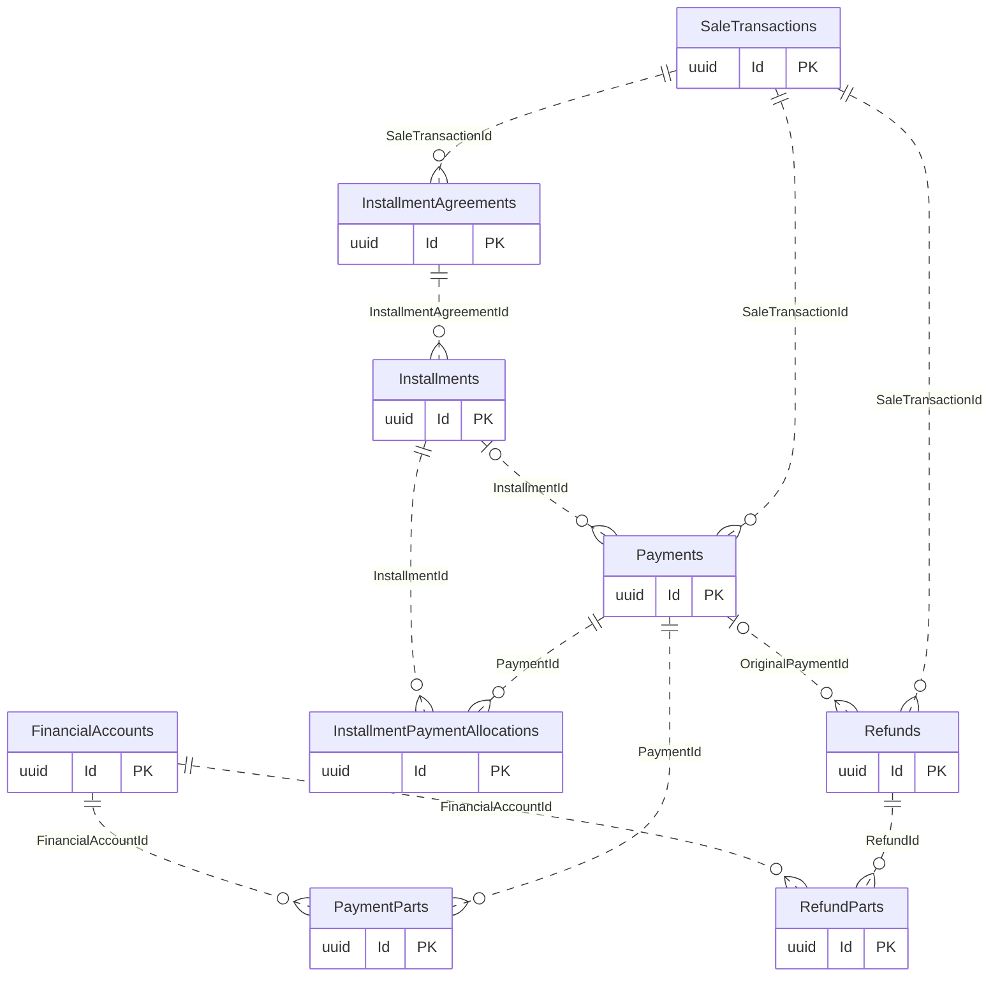
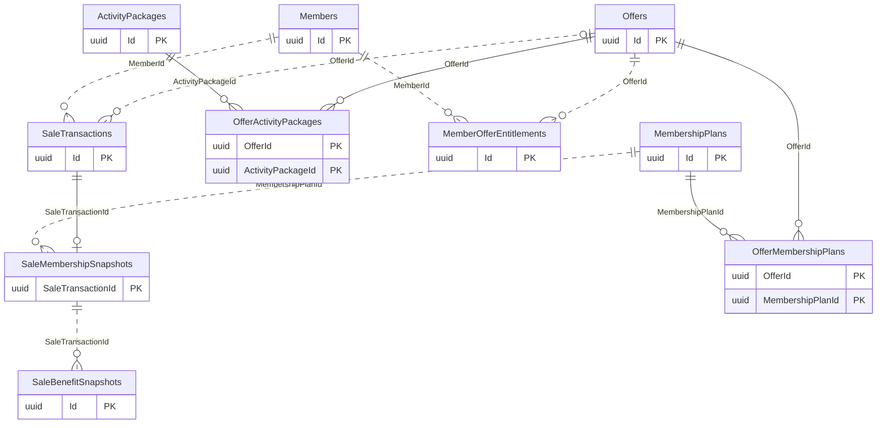

# Sales and Payments

[Navigation](README.md) · [All tables](TABLE_INVENTORY.md) · [Review flags](REVIEW_FLAGS.md)

**14 tables.** A sale records what was sold; a payment records actual collection. PaymentParts and RefundParts explain account splits; FinancialTransactions holds actual account movement. Do not add all these amounts together. Stored prices and benefits preserve the agreement even after catalog edits.

## Read the diagrams

Only the relationships needed to understand this module are shown. Repeated boundary
boxes belong to other modules and are not counted twice. Routine authorizer/creator
FKs are usually omitted from diagrams; the table cards below list all actual FKs.
Use the [legend](OVERVIEW.md) for optional and one-to-many symbols.

### Collections, refunds and installments

### Sold terms and offer eligibility

## Table details

Required/optional means SQL FK nullability, not unconditional permission to omit the
field from an API request; CHECK constraints and services can impose stricter rules.
The category describes its responsibility; history/evidence does not by itself
mean every column is immutable. Exact columns, CHECK SQL and indexes are in [schema.json](schema.json).

### SaleTransactions

Stores sold products, amounts, attribution snapshots and cancellation facts.

- **Kind:** Core / evidence.
- **PK:** `Id` (uuid).
- **FKs:**
  - `BranchId` → [GymBranches](01-auth-employees-branches.md#gymbranches).`Id` (required, many children per parent, delete Restrict).
  - `BusinessDayId` → [BusinessDays](05-shifts-vault-expenses.md#businessdays).`Id` (optional, many children per parent, delete Restrict).
  - `CancelledByUserId` → [AspNetUsers](01-auth-employees-branches.md#aspnetusers).`Id` (optional, many children per parent, delete Restrict).
  - `CreatedByUserId` → [AspNetUsers](01-auth-employees-branches.md#aspnetusers).`Id` (required, many children per parent, delete Restrict).
  - `CreatedShiftId` → [Shifts](05-shifts-vault-expenses.md#shifts).`Id` (optional, many children per parent, delete Restrict).
  - `MemberId` → [Members](02-members-crm.md#members).`Id` (required, many children per parent, delete Restrict).
  - `OfferAudienceCategoryIdSnapshot` → [MembershipPlanCategories](03-subscriptions-check-in.md#membershipplancategories).`Id` (optional, many children per parent, delete Restrict).
  - `OfferId` → [Offers](04-sales-payments.md#offers).`Id` (optional, many children per parent, delete Restrict).
  - `SalesEmployeeId` → [Employees](01-auth-employees-branches.md#employees).`Id` (optional, many children per parent, delete Restrict).
- **Unique indexes:** `OperationId`.
- **Sources:** [SaleTransaction.cs](../../CampionsSystem.DAL/Entities/SaleTransaction.cs), [SaleTransactionConfiguration.cs](../../CampionsSystem.DAL/Configurations/SaleTransactionConfiguration.cs).

### SaleMembershipSnapshots

Stores the regular membership terms frozen for a sale.

- **Kind:** Evidence.
- **PK:** `SaleTransactionId` (uuid).
- **FKs:**
  - `AudienceCategoryId` → [MembershipPlanCategories](03-subscriptions-check-in.md#membershipplancategories).`Id` (optional, many children per parent, delete Restrict).
  - `CityId` → [Cities](01-auth-employees-branches.md#cities).`Id` (required, many children per parent, delete Restrict).
  - `FreelanceCoachEmployeeId` → [Employees](01-auth-employees-branches.md#employees).`Id` (optional, many children per parent, delete Restrict).
  - `MembershipPlanId` → [MembershipPlans](03-subscriptions-check-in.md#membershipplans).`Id` (required, many children per parent, delete Restrict).
  - `SaleTransactionId` → [SaleTransactions](04-sales-payments.md#saletransactions).`Id` (required, at most one child per parent, delete Restrict).
- **Sources:** [SaleMembershipSnapshot.cs](../../CampionsSystem.DAL/Entities/SaleMembershipSnapshot.cs), [SalesWorkflowConfiguration.cs](../../CampionsSystem.DAL/Configurations/SalesWorkflowConfiguration.cs).

### SaleBenefitSnapshots

Stores the membership benefits promised in a sale snapshot.

- **Kind:** Evidence.
- **PK:** `Id` (uuid).
- **FKs:**
  - `MembershipBenefitId` → [MembershipBenefits](03-subscriptions-check-in.md#membershipbenefits).`Id` (required, many children per parent, delete Restrict).
  - `SaleTransactionId` → [SaleMembershipSnapshots](04-sales-payments.md#salemembershipsnapshots).`SaleTransactionId` (required, many children per parent, delete Restrict).
- **Unique indexes:** `SaleTransactionId, MembershipBenefitId`.
- **Sources:** [SaleBenefitSnapshot.cs](../../CampionsSystem.DAL/Entities/SaleBenefitSnapshot.cs), [SalesWorkflowConfiguration.cs](../../CampionsSystem.DAL/Configurations/SalesWorkflowConfiguration.cs).

### Payments

Stores member collections and the user who received them.

- **Kind:** Core / evidence.
- **PK:** `Id` (uuid).
- **FKs:**
  - `BranchId` → [GymBranches](01-auth-employees-branches.md#gymbranches).`Id` (required, many children per parent, delete Restrict).
  - `BusinessDayId` → [BusinessDays](05-shifts-vault-expenses.md#businessdays).`Id` (optional, many children per parent, delete Restrict).
  - `CommissionPeriodId` → [CommissionPeriods](06-commissions.md#commissionperiods).`Id` (optional, many children per parent, delete Restrict).
  - `InstallmentId` → [Installments](04-sales-payments.md#installments).`Id` (optional, many children per parent, delete Restrict).
  - `ReceivedByUserId` → [AspNetUsers](01-auth-employees-branches.md#aspnetusers).`Id` (required, many children per parent, delete Restrict).
  - `SaleTransactionId` → [SaleTransactions](04-sales-payments.md#saletransactions).`Id` (required, many children per parent, delete Restrict).
  - `ShiftId` → [Shifts](05-shifts-vault-expenses.md#shifts).`Id` (optional, many children per parent, delete Restrict).
- **Unique indexes:** `OperationId`.
- **Sources:** [Payment.cs](../../CampionsSystem.DAL/Entities/Payment.cs), [PaymentConfiguration.cs](../../CampionsSystem.DAL/Configurations/PaymentConfiguration.cs).

### PaymentParts

Stores each payment's allocation across financial accounts and provider references.

- **Kind:** Evidence / junction.
- **PK:** `Id` (uuid).
- **FKs:**
  - `FinancialAccountId` → [FinancialAccounts](05-shifts-vault-expenses.md#financialaccounts).`Id` (required, many children per parent, delete Restrict).
  - `PaymentId` → [Payments](04-sales-payments.md#payments).`Id` (required, many children per parent, delete Restrict).
- **Sources:** [PaymentPart.cs](../../CampionsSystem.DAL/Entities/PaymentPart.cs), [PaymentPartConfiguration.cs](../../CampionsSystem.DAL/Configurations/PaymentPartConfiguration.cs).

### Refunds

Stores returned member money, reasons and original sale/payment links.

- **Kind:** Core / evidence.
- **PK:** `Id` (uuid).
- **FKs:**
  - `ApprovedByUserId` → [AspNetUsers](01-auth-employees-branches.md#aspnetusers).`Id` (optional, many children per parent, delete Restrict).
  - `BranchId` → [GymBranches](01-auth-employees-branches.md#gymbranches).`Id` (required, many children per parent, delete Restrict).
  - `BusinessDayId` → [BusinessDays](05-shifts-vault-expenses.md#businessdays).`Id` (optional, many children per parent, delete Restrict).
  - `OriginalPaymentId` → [Payments](04-sales-payments.md#payments).`Id` (optional, many children per parent, delete Restrict).
  - `ProcessedByUserId` → [AspNetUsers](01-auth-employees-branches.md#aspnetusers).`Id` (required, many children per parent, delete Restrict).
  - `SaleTransactionId` → [SaleTransactions](04-sales-payments.md#saletransactions).`Id` (required, many children per parent, delete Restrict).
  - `ShiftId` → [Shifts](05-shifts-vault-expenses.md#shifts).`Id` (optional, many children per parent, delete Restrict).
- **Unique indexes:** `OperationId`.
- **Sources:** [Refund.cs](../../CampionsSystem.DAL/Entities/Refund.cs), [RefundConfiguration.cs](../../CampionsSystem.DAL/Configurations/RefundConfiguration.cs).

### RefundParts

Stores each refund's outbound account allocation and provider reference.

- **Kind:** Evidence / junction.
- **PK:** `Id` (uuid).
- **FKs:**
  - `FinancialAccountId` → [FinancialAccounts](05-shifts-vault-expenses.md#financialaccounts).`Id` (required, many children per parent, delete Restrict).
  - `RefundId` → [Refunds](04-sales-payments.md#refunds).`Id` (required, many children per parent, delete Restrict).
- **Sources:** [RefundPart.cs](../../CampionsSystem.DAL/Entities/RefundPart.cs), [RefundPartConfiguration.cs](../../CampionsSystem.DAL/Configurations/RefundPartConfiguration.cs).

### InstallmentAgreements

Stores an installment schedule agreed for a sale.

- **Kind:** Core.
- **PK:** `Id` (uuid).
- **FKs:**
  - `CreatedByUserId` → [AspNetUsers](01-auth-employees-branches.md#aspnetusers).`Id` (required, many children per parent, delete Restrict).
  - `SaleTransactionId` → [SaleTransactions](04-sales-payments.md#saletransactions).`Id` (required, many children per parent, delete Restrict).
- **Sources:** [InstallmentAgreement.cs](../../CampionsSystem.DAL/Entities/InstallmentAgreement.cs), [InstallmentAgreementConfiguration.cs](../../CampionsSystem.DAL/Configurations/InstallmentAgreementConfiguration.cs).

### Installments

Stores individual installment due amounts, dates and paid balances.

- **Kind:** Core.
- **PK:** `Id` (uuid).
- **FKs:**
  - `InstallmentAgreementId` → [InstallmentAgreements](04-sales-payments.md#installmentagreements).`Id` (required, many children per parent, delete Restrict).
- **Unique indexes:** `InstallmentAgreementId, InstallmentNumber`.
- **Sources:** [Installment.cs](../../CampionsSystem.DAL/Entities/Installment.cs), [InstallmentConfiguration.cs](../../CampionsSystem.DAL/Configurations/InstallmentConfiguration.cs).

### InstallmentPaymentAllocations

Links actual payments to the installments they fund.

- **Kind:** Evidence / junction.
- **PK:** `Id` (uuid).
- **FKs:**
  - `InstallmentId` → [Installments](04-sales-payments.md#installments).`Id` (required, many children per parent, delete Restrict).
  - `PaymentId` → [Payments](04-sales-payments.md#payments).`Id` (required, many children per parent, delete Restrict).
- **Unique indexes:** `PaymentId, InstallmentId`.
- **Sources:** [InstallmentPaymentAllocation.cs](../../CampionsSystem.DAL/Entities/InstallmentPaymentAllocation.cs), [SalesWorkflowConfiguration.cs](../../CampionsSystem.DAL/Configurations/SalesWorkflowConfiguration.cs).

### Offers

Stores promotions, discount rules and eligibility descriptions.

- **Kind:** Configuration.
- **PK:** `Id` (uuid).
- **FKs:**
  - `AudienceCategoryId` → [MembershipPlanCategories](03-subscriptions-check-in.md#membershipplancategories).`Id` (optional, many children per parent, delete Restrict).
  - `BranchId` → [GymBranches](01-auth-employees-branches.md#gymbranches).`Id` (optional, many children per parent, delete Restrict).
  - `CreatedByUserId` → [AspNetUsers](01-auth-employees-branches.md#aspnetusers).`Id` (required, many children per parent, delete Restrict).
- **Sources:** [Offer.cs](../../CampionsSystem.DAL/Entities/Offer.cs), [OfferConfiguration.cs](../../CampionsSystem.DAL/Configurations/OfferConfiguration.cs).

### OfferMembershipPlans

Links offers to eligible membership plans.

- **Kind:** Configuration / junction.
- **PK:** `OfferId` (uuid), `MembershipPlanId` (uuid).
- **FKs:**
  - `MembershipPlanId` → [MembershipPlans](03-subscriptions-check-in.md#membershipplans).`Id` (required, many children per parent, delete Restrict).
  - `OfferId` → [Offers](04-sales-payments.md#offers).`Id` (required, many children per parent, delete Restrict).
- **Sources:** [OfferMembershipPlan.cs](../../CampionsSystem.DAL/Entities/OfferMembershipPlan.cs), [OfferMembershipPlanConfiguration.cs](../../CampionsSystem.DAL/Configurations/OfferMembershipPlanConfiguration.cs).

### OfferActivityPackages

Links offers to eligible activity packages.

- **Kind:** Configuration / junction.
- **PK:** `OfferId` (uuid), `ActivityPackageId` (uuid).
- **FKs:**
  - `ActivityPackageId` → [ActivityPackages](07-private-classes.md#activitypackages).`Id` (required, many children per parent, delete Restrict).
  - `OfferId` → [Offers](04-sales-payments.md#offers).`Id` (required, many children per parent, delete Restrict).
- **Sources:** [OfferActivityPackage.cs](../../CampionsSystem.DAL/Entities/OfferActivityPackage.cs), [OfferActivityPackageConfiguration.cs](../../CampionsSystem.DAL/Configurations/OfferActivityPackageConfiguration.cs).

### MemberOfferEntitlements

Stores explicit member offer grants and revocation facts.

- **Kind:** History / evidence.
- **PK:** `Id` (uuid).
- **FKs:**
  - `CreatedByUserId` → [AspNetUsers](01-auth-employees-branches.md#aspnetusers).`Id` (required, many children per parent, delete Restrict).
  - `GrantedByEmployeeId` → [Employees](01-auth-employees-branches.md#employees).`Id` (optional, many children per parent, delete Restrict).
  - `MemberId` → [Members](02-members-crm.md#members).`Id` (required, many children per parent, delete Restrict).
  - `OfferId` → [Offers](04-sales-payments.md#offers).`Id` (required, many children per parent, delete Restrict).
  - `RevokedByUserId` → [AspNetUsers](01-auth-employees-branches.md#aspnetusers).`Id` (optional, many children per parent, delete Restrict).
- **Sources:** [MemberOfferEntitlement.cs](../../CampionsSystem.DAL/Entities/MemberOfferEntitlement.cs), [MemberOfferEntitlementConfiguration.cs](../../CampionsSystem.DAL/Configurations/MemberOfferEntitlementConfiguration.cs).

