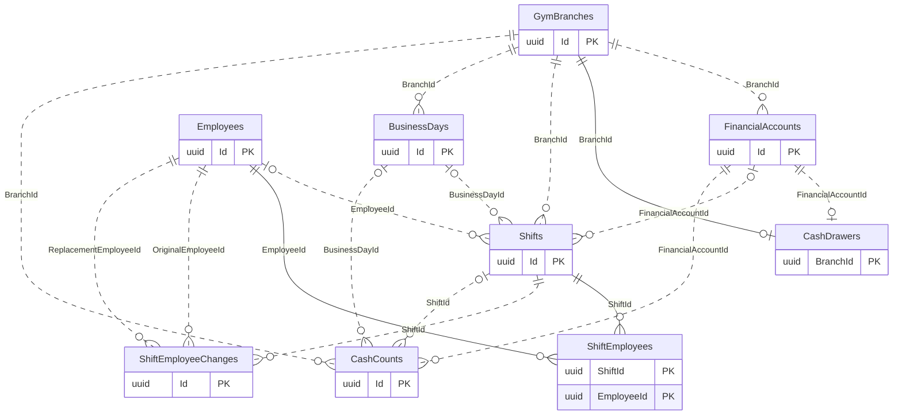
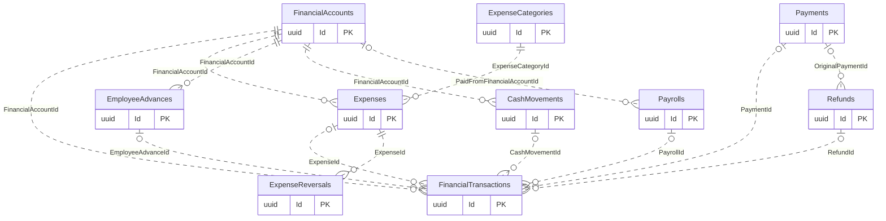

# Shifts, Vault and Expenses

[Navigation](README.md) · [All tables](TABLE_INVENTORY.md) · [Review flags](REVIEW_FLAGS.md)

**13 tables.** A branch has one configured shared cash drawer, while employees may have overlapping shifts. FinancialTransactions is the movement ledger; CashCounts is observed physical evidence, not another payment. OpeningBalance is on FinancialAccounts, not a historical ledger credit. Shift participants and shift-change history must not be summed as separate drawers.

## Read the diagrams

Only the relationships needed to understand this module are shown. Repeated boundary
boxes belong to other modules and are not counted twice. Routine authorizer/creator
FKs are usually omitted from diagrams; the table cards below list all actual FKs.
Use the [legend](OVERVIEW.md) for optional and one-to-many symbols.

### Branch drawer and overlapping shifts

### Actual money movements

## Table details

Required/optional means SQL FK nullability, not unconditional permission to omit the
field from an API request; CHECK constraints and services can impose stricter rules.
The category describes its responsibility; history/evidence does not by itself
mean every column is immutable. Exact columns, CHECK SQL and indexes are in [schema.json](schema.json).

### FinancialAccounts

Stores branch Cash/InstaPay accounts and their opening balances.

- **Kind:** Configuration / core.
- **PK:** `Id` (uuid).
- **FKs:**
  - `BranchId` → [GymBranches](01-auth-employees-branches.md#gymbranches).`Id` (required, many children per parent, delete Restrict).
- **Sources:** [FinancialAccount.cs](../../CampionsSystem.DAL/Entities/FinancialAccount.cs), [FinancialAccountConfiguration.cs](../../CampionsSystem.DAL/Configurations/FinancialAccountConfiguration.cs).

### FinancialTransactions

Stores actual account credits/debits and their source references.

- **Kind:** Core ledger / evidence.
- **PK:** `Id` (uuid).
- **FKs:**
  - `BranchId` → [GymBranches](01-auth-employees-branches.md#gymbranches).`Id` (required, many children per parent, delete Restrict).
  - `BusinessDayId` → [BusinessDays](05-shifts-vault-expenses.md#businessdays).`Id` (optional, many children per parent, delete Restrict).
  - `CashMovementId` → [CashMovements](05-shifts-vault-expenses.md#cashmovements).`Id` (optional, many children per parent, delete Restrict).
  - `CreatedByUserId` → [AspNetUsers](01-auth-employees-branches.md#aspnetusers).`Id` (required, many children per parent, delete Restrict).
  - `EmployeeAdvanceId` → [EmployeeAdvances](05-shifts-vault-expenses.md#employeeadvances).`Id` (optional, many children per parent, delete Restrict).
  - `ExpenseId` → [Expenses](05-shifts-vault-expenses.md#expenses).`Id` (optional, many children per parent, delete Restrict).
  - `FinancialAccountId` → [FinancialAccounts](05-shifts-vault-expenses.md#financialaccounts).`Id` (required, many children per parent, delete Restrict).
  - `FinancialMonthId` → [FinancialMonths](08-monthly-closing-payroll.md#financialmonths).`Id` (optional, many children per parent, delete Restrict).
  - `PaymentId` → [Payments](04-sales-payments.md#payments).`Id` (optional, many children per parent, delete Restrict).
  - `PayrollId` → [Payrolls](08-monthly-closing-payroll.md#payrolls).`Id` (optional, many children per parent, delete Restrict).
  - `RefundId` → [Refunds](04-sales-payments.md#refunds).`Id` (optional, many children per parent, delete Restrict).
  - `ShiftId` → [Shifts](05-shifts-vault-expenses.md#shifts).`Id` (optional, many children per parent, delete Restrict).
- **Unique indexes:** `BranchId, DrawerSequence` where `"DrawerSequence" IS NOT NULL`.
- **Sources:** [FinancialTransaction.cs](../../CampionsSystem.DAL/Entities/FinancialTransaction.cs), [FinancialTransactionConfiguration.cs](../../CampionsSystem.DAL/Configurations/FinancialTransactionConfiguration.cs).

### Shifts

Stores employee shifts, cash count snapshots and closing discrepancies.

- **Kind:** Core / history.
- **PK:** `Id` (uuid).
- **FKs:**
  - `BranchId` → [GymBranches](01-auth-employees-branches.md#gymbranches).`Id` (required, many children per parent, delete Restrict).
  - `BusinessDayId` → [BusinessDays](05-shifts-vault-expenses.md#businessdays).`Id` (optional, many children per parent, delete Restrict).
  - `ClosedByUserId` → [AspNetUsers](01-auth-employees-branches.md#aspnetusers).`Id` (optional, many children per parent, delete Restrict).
  - `EmployeeId` → [Employees](01-auth-employees-branches.md#employees).`Id` (optional, many children per parent, delete Restrict).
  - `FinancialAccountId` → [FinancialAccounts](05-shifts-vault-expenses.md#financialaccounts).`Id` (optional, many children per parent, delete Restrict).
  - `OpenedByUserId` → [AspNetUsers](01-auth-employees-branches.md#aspnetusers).`Id` (required, many children per parent, delete Restrict).
- **Unique indexes:** `CloseOperationId`; `EmployeeId` where `"Status" = 'Open' AND "EmployeeId" IS NOT NULL`; `OperationId`.
- **Sources:** [Shift.cs](../../CampionsSystem.DAL/Entities/Shift.cs), [ShiftConfiguration.cs](../../CampionsSystem.DAL/Configurations/ShiftConfiguration.cs).

### ShiftEmployees

Stores employee participation intervals associated with shifts.

- **Kind:** Junction / history.
- **PK:** `ShiftId` (uuid), `EmployeeId` (uuid).
- **FKs:**
  - `EmployeeId` → [Employees](01-auth-employees-branches.md#employees).`Id` (required, many children per parent, delete Restrict).
  - `ShiftId` → [Shifts](05-shifts-vault-expenses.md#shifts).`Id` (required, many children per parent, delete Restrict).
- **Sources:** [ShiftEmployee.cs](../../CampionsSystem.DAL/Entities/ShiftEmployee.cs), [ShiftEmployeeConfiguration.cs](../../CampionsSystem.DAL/Configurations/ShiftEmployeeConfiguration.cs).

### ShiftEmployeeChanges

Stores recorded changes to shift employee participation.

- **Kind:** History.
- **PK:** `Id` (uuid).
- **FKs:**
  - `ChangedByUserId` → [AspNetUsers](01-auth-employees-branches.md#aspnetusers).`Id` (required, many children per parent, delete Restrict).
  - `OriginalEmployeeId` → [Employees](01-auth-employees-branches.md#employees).`Id` (required, many children per parent, delete Restrict).
  - `ReplacementEmployeeId` → [Employees](01-auth-employees-branches.md#employees).`Id` (required, many children per parent, delete Restrict).
  - `ShiftId` → [Shifts](05-shifts-vault-expenses.md#shifts).`Id` (required, many children per parent, delete Restrict).
- **Sources:** [ShiftEmployeeChange.cs](../../CampionsSystem.DAL/Entities/ShiftEmployeeChange.cs), [ShiftEmployeeChangeConfiguration.cs](../../CampionsSystem.DAL/Configurations/ShiftEmployeeChangeConfiguration.cs).

### BusinessDays

Stores each branch's explicitly opened and closed business dates.

- **Kind:** Core / configuration.
- **PK:** `Id` (uuid).
- **FKs:**
  - `BranchId` → [GymBranches](01-auth-employees-branches.md#gymbranches).`Id` (required, many children per parent, delete Restrict).
  - `ClosedByUserId` → [AspNetUsers](01-auth-employees-branches.md#aspnetusers).`Id` (optional, many children per parent, delete Restrict).
  - `OpenedByUserId` → [AspNetUsers](01-auth-employees-branches.md#aspnetusers).`Id` (optional, many children per parent, delete Restrict).
- **Unique indexes:** `BranchId` where `"Status" = 'Open'`; `BranchId, BusinessDate`.
- **Sources:** [BusinessDay.cs](../../CampionsSystem.DAL/Entities/BusinessDay.cs), [BusinessDayConfiguration.cs](../../CampionsSystem.DAL/Configurations/BusinessDayConfiguration.cs).

### CashDrawers

Links one shared branch drawer to its financial account and movement sequence.

- **Kind:** Configuration / core.
- **PK:** `BranchId` (uuid).
- **FKs:**
  - `BranchId` → [GymBranches](01-auth-employees-branches.md#gymbranches).`Id` (required, at most one child per parent, delete Restrict).
  - `CreatedByUserId` → [AspNetUsers](01-auth-employees-branches.md#aspnetusers).`Id` (required, many children per parent, delete Restrict).
  - `FinancialAccountId` → [FinancialAccounts](05-shifts-vault-expenses.md#financialaccounts).`Id` (required, at most one child per parent, delete Restrict).
- **Unique indexes:** `FinancialAccountId`; `OperationId`.
- **Sources:** [CashDrawer.cs](../../CampionsSystem.DAL/Entities/CashDrawer.cs), [CashDrawerConfiguration.cs](../../CampionsSystem.DAL/Configurations/CashDrawerConfiguration.cs).

### CashCounts

Stores physical cash observations, expected/book cash and discrepancies.

- **Kind:** Evidence.
- **PK:** `Id` (uuid).
- **FKs:**
  - `BranchId` → [GymBranches](01-auth-employees-branches.md#gymbranches).`Id` (required, many children per parent, delete Restrict).
  - `BusinessDayId` → [BusinessDays](05-shifts-vault-expenses.md#businessdays).`Id` (optional, many children per parent, delete Restrict).
  - `CreatedByUserId` → [AspNetUsers](01-auth-employees-branches.md#aspnetusers).`Id` (required, many children per parent, delete Restrict).
  - `FinancialAccountId` → [FinancialAccounts](05-shifts-vault-expenses.md#financialaccounts).`Id` (required, many children per parent, delete Restrict).
  - `ShiftId` → [Shifts](05-shifts-vault-expenses.md#shifts).`Id` (optional, many children per parent, delete Restrict).
- **Unique indexes:** `OperationId`.
- **Sources:** [CashCount.cs](../../CampionsSystem.DAL/Entities/CashCount.cs), [CashCountConfiguration.cs](../../CampionsSystem.DAL/Configurations/CashCountConfiguration.cs).

### CashMovements

Stores authorized branch cash movement or withdrawal records.

- **Kind:** Core / evidence.
- **PK:** `Id` (uuid).
- **FKs:**
  - `BranchId` → [GymBranches](01-auth-employees-branches.md#gymbranches).`Id` (required, many children per parent, delete Restrict).
  - `BusinessDayId` → [BusinessDays](05-shifts-vault-expenses.md#businessdays).`Id` (optional, many children per parent, delete Restrict).
  - `CreatedByUserId` → [AspNetUsers](01-auth-employees-branches.md#aspnetusers).`Id` (required, many children per parent, delete Restrict).
  - `FinancialAccountId` → [FinancialAccounts](05-shifts-vault-expenses.md#financialaccounts).`Id` (required, many children per parent, delete Restrict).
  - `ShiftId` → [Shifts](05-shifts-vault-expenses.md#shifts).`Id` (optional, many children per parent, delete Restrict).
- **Unique indexes:** `OperationId`.
- **Sources:** [CashMovement.cs](../../CampionsSystem.DAL/Entities/CashMovement.cs), [CashMovementConfiguration.cs](../../CampionsSystem.DAL/Configurations/CashMovementConfiguration.cs).

### Expenses

Stores expense requests, payment facts, category and receipt references.

- **Kind:** Core / evidence.
- **PK:** `Id` (uuid).
- **FKs:**
  - `ApprovedByUserId` → [AspNetUsers](01-auth-employees-branches.md#aspnetusers).`Id` (optional, many children per parent, delete Restrict).
  - `BranchId` → [GymBranches](01-auth-employees-branches.md#gymbranches).`Id` (required, many children per parent, delete Restrict).
  - `BusinessDayId` → [BusinessDays](05-shifts-vault-expenses.md#businessdays).`Id` (optional, many children per parent, delete Restrict).
  - `CreatedByUserId` → [AspNetUsers](01-auth-employees-branches.md#aspnetusers).`Id` (required, many children per parent, delete Restrict).
  - `ExpenseCategoryId` → [ExpenseCategories](05-shifts-vault-expenses.md#expensecategories).`Id` (required, many children per parent, delete Restrict).
  - `FinancialAccountId` → [FinancialAccounts](05-shifts-vault-expenses.md#financialaccounts).`Id` (required, many children per parent, delete Restrict).
  - `RecordingEmployeeId` → [Employees](01-auth-employees-branches.md#employees).`Id` (optional, many children per parent, delete Restrict).
  - `ShiftId` → [Shifts](05-shifts-vault-expenses.md#shifts).`Id` (optional, many children per parent, delete Restrict).
- **Unique indexes:** `OperationId`.
- **Sources:** [Expense.cs](../../CampionsSystem.DAL/Entities/Expense.cs), [ExpenseConfiguration.cs](../../CampionsSystem.DAL/Configurations/ExpenseConfiguration.cs).

### ExpenseCategories

Stores the categories used to classify expenses.

- **Kind:** Configuration.
- **PK:** `Id` (uuid).
- **FKs:** none.
- **Unique indexes:** `Name`.
- **Sources:** [ExpenseCategory.cs](../../CampionsSystem.DAL/Entities/ExpenseCategory.cs), [ExpenseCategoryConfiguration.cs](../../CampionsSystem.DAL/Configurations/ExpenseCategoryConfiguration.cs).

### ExpenseReversals

Stores money returned against an expense without erasing its payment.

- **Kind:** Evidence.
- **PK:** `Id` (uuid).
- **FKs:**
  - `BranchId` → [GymBranches](01-auth-employees-branches.md#gymbranches).`Id` (required, many children per parent, delete Restrict).
  - `BusinessDayId` → [BusinessDays](05-shifts-vault-expenses.md#businessdays).`Id` (optional, many children per parent, delete Restrict).
  - `CreatedByUserId` → [AspNetUsers](01-auth-employees-branches.md#aspnetusers).`Id` (required, many children per parent, delete Restrict).
  - `ExpenseId` → [Expenses](05-shifts-vault-expenses.md#expenses).`Id` (required, many children per parent, delete Restrict).
  - `ShiftId` → [Shifts](05-shifts-vault-expenses.md#shifts).`Id` (required, many children per parent, delete Restrict).
- **Unique indexes:** `OperationId`.
- **Sources:** [ExpenseReversal.cs](../../CampionsSystem.DAL/Entities/ExpenseReversal.cs), [ExpenseReversalConfiguration.cs](../../CampionsSystem.DAL/Configurations/ExpenseReversalConfiguration.cs).

### EmployeeAdvances

Stores actual employee advances with branch, funding account and salary ceiling evidence.

- **Kind:** Core / evidence.
- **PK:** `Id` (uuid).
- **FKs:**
  - `BranchId` → [GymBranches](01-auth-employees-branches.md#gymbranches).`Id` (required, many children per parent, delete Restrict).
  - `BusinessDayId` → [BusinessDays](05-shifts-vault-expenses.md#businessdays).`Id` (optional, many children per parent, delete Restrict).
  - `CreatedByUserId` → [AspNetUsers](01-auth-employees-branches.md#aspnetusers).`Id` (required, many children per parent, delete Restrict).
  - `FinancialAccountId` → [FinancialAccounts](05-shifts-vault-expenses.md#financialaccounts).`Id` (required, many children per parent, delete Restrict).
  - `FinancialMonthId` → [FinancialMonths](08-monthly-closing-payroll.md#financialmonths).`Id` (optional, many children per parent, delete Restrict).
  - `ReceivingEmployeeId` → [Employees](01-auth-employees-branches.md#employees).`Id` (required, many children per parent, delete Restrict).
  - `RecordingEmployeeId` → [Employees](01-auth-employees-branches.md#employees).`Id` (required, many children per parent, delete Restrict).
  - `ShiftId` → [Shifts](05-shifts-vault-expenses.md#shifts).`Id` (required, many children per parent, delete Restrict).
- **Unique indexes:** `OperationId`.
- **Sources:** [EmployeeAdvance.cs](../../CampionsSystem.DAL/Entities/EmployeeAdvance.cs), [EmployeeAdvanceConfiguration.cs](../../CampionsSystem.DAL/Configurations/EmployeeAdvanceConfiguration.cs).

