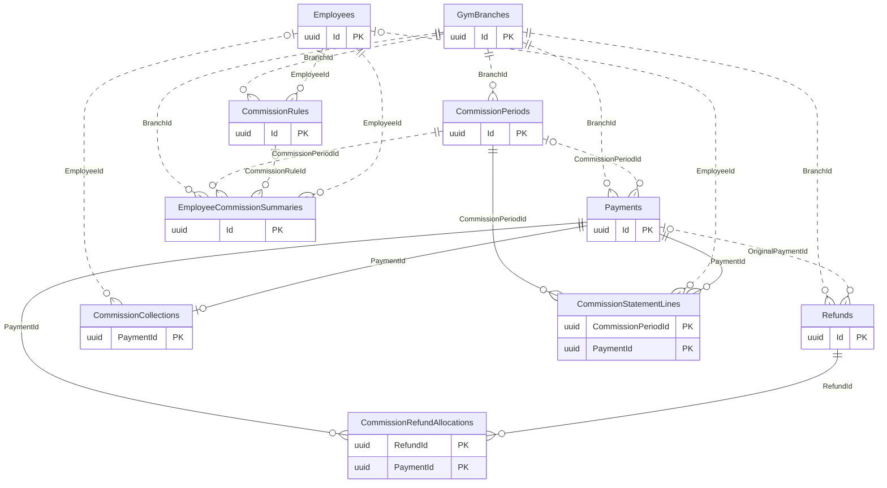

# Sales Commissions

[Navigation](README.md) · [All tables](TABLE_INVENTORY.md) · [Review flags](REVIEW_FLAGS.md)

**6 tables.** CommissionCollections freezes commercial attribution per collection. It is not a payment ledger or a rule based on cashier identity. Finalized statement lines and employee summaries preserve the period result; configuration and live progress remain separate. A Manager can be a Sales employee on the same account.

## Read the diagrams

Only the relationships needed to understand this module are shown. Repeated boundary
boxes belong to other modules and are not counted twice. Routine authorizer/creator
FKs are usually omitted from diagrams; the table cards below list all actual FKs.
Use the [legend](OVERVIEW.md) for optional and one-to-many symbols.

### Collections to finalized statements

## Table details

Required/optional means SQL FK nullability, not unconditional permission to omit the
field from an API request; CHECK constraints and services can impose stricter rules.
The category describes its responsibility; history/evidence does not by itself
mean every column is immutable. Exact columns, CHECK SQL and indexes are in [schema.json](schema.json).

### CommissionPeriods

Stores branch commission evaluation boundaries and finalization metadata.

- **Kind:** Configuration / history.
- **PK:** `Id` (uuid).
- **FKs:**
  - `BranchId` → [GymBranches](01-auth-employees-branches.md#gymbranches).`Id` (required, many children per parent, delete Restrict).
  - `ClosedByUserId` → [AspNetUsers](01-auth-employees-branches.md#aspnetusers).`Id` (optional, many children per parent, delete Restrict).
  - `ReopenedByUserId` → [AspNetUsers](01-auth-employees-branches.md#aspnetusers).`Id` (optional, many children per parent, delete Restrict).
- **Unique indexes:** `BranchId` where `"Status" = 'Open'`; `CloseOperationId`; `OperationId`.
- **Sources:** [CommissionPeriod.cs](../../CampionsSystem.DAL/Entities/CommissionPeriod.cs), [CommissionPeriodConfiguration.cs](../../CampionsSystem.DAL/Configurations/CommissionPeriodConfiguration.cs).

### CommissionRules

Stores configurable employee or branch commission targets and rates.

- **Kind:** Configuration / history.
- **PK:** `Id` (uuid).
- **FKs:**
  - `BranchId` → [GymBranches](01-auth-employees-branches.md#gymbranches).`Id` (required, many children per parent, delete Restrict).
  - `CreatedByUserId` → [AspNetUsers](01-auth-employees-branches.md#aspnetusers).`Id` (required, many children per parent, delete Restrict).
  - `EmployeeId` → [Employees](01-auth-employees-branches.md#employees).`Id` (optional, many children per parent, delete Restrict).
  - `GroupClassId` → [GroupClasses](07-private-classes.md#groupclasses).`Id` (optional, many children per parent, delete Restrict).
  - `SportsActivityId` → [SportsActivities](07-private-classes.md#sportsactivities).`Id` (optional, many children per parent, delete Restrict).
- **Unique indexes:** `OperationId, CommissionType`.
- **Sources:** [CommissionRule.cs](../../CampionsSystem.DAL/Entities/CommissionRule.cs), [CommissionRuleConfiguration.cs](../../CampionsSystem.DAL/Configurations/CommissionRuleConfiguration.cs).

### CommissionCollections

Stores collection-time commercial employee attribution and eligibility per payment.

- **Kind:** Evidence.
- **PK:** `PaymentId` (uuid).
- **FKs:**
  - `EmployeeId` → [Employees](01-auth-employees-branches.md#employees).`Id` (optional, many children per parent, delete Restrict).
  - `PaymentId` → [Payments](04-sales-payments.md#payments).`Id` (required, at most one child per parent, delete Restrict).
- **Sources:** [CommissionCollection.cs](../../CampionsSystem.DAL/Entities/CommissionCollection.cs), [CommissionCollectionConfiguration.cs](../../CampionsSystem.DAL/Configurations/CommissionCollectionConfiguration.cs).

### CommissionRefundAllocations

Links refunded amounts to the original commission collection payments.

- **Kind:** Evidence / junction.
- **PK:** `RefundId` (uuid), `PaymentId` (uuid).
- **FKs:**
  - `PaymentId` → [Payments](04-sales-payments.md#payments).`Id` (required, many children per parent, delete Restrict).
  - `RefundId` → [Refunds](04-sales-payments.md#refunds).`Id` (required, many children per parent, delete Restrict).
- **Sources:** [CommissionCollection.cs](../../CampionsSystem.DAL/Entities/CommissionCollection.cs), [CommissionCollectionConfiguration.cs](../../CampionsSystem.DAL/Configurations/CommissionCollectionConfiguration.cs).

### CommissionStatementLines

Stores finalized period source lines including eligible, House and excluded collections.

- **Kind:** Evidence / junction.
- **PK:** `CommissionPeriodId` (uuid), `PaymentId` (uuid).
- **FKs:**
  - `CommissionPeriodId` → [CommissionPeriods](06-commissions.md#commissionperiods).`Id` (required, many children per parent, delete Restrict).
  - `EmployeeId` → [Employees](01-auth-employees-branches.md#employees).`Id` (optional, many children per parent, delete Restrict).
  - `PaymentId` → [Payments](04-sales-payments.md#payments).`Id` (required, many children per parent, delete Restrict).
- **Sources:** [CommissionCollection.cs](../../CampionsSystem.DAL/Entities/CommissionCollection.cs), [CommissionCollectionConfiguration.cs](../../CampionsSystem.DAL/Configurations/CommissionCollectionConfiguration.cs).

### EmployeeCommissionSummaries

Stores finalized employee commission totals, targets and rate snapshots.

- **Kind:** Evidence.
- **PK:** `Id` (uuid).
- **FKs:**
  - `BranchId` → [GymBranches](01-auth-employees-branches.md#gymbranches).`Id` (required, many children per parent, delete Restrict).
  - `CommissionPeriodId` → [CommissionPeriods](06-commissions.md#commissionperiods).`Id` (required, many children per parent, delete Restrict).
  - `CommissionRuleId` → [CommissionRules](06-commissions.md#commissionrules).`Id` (optional, many children per parent, delete Restrict).
  - `EmployeeId` → [Employees](01-auth-employees-branches.md#employees).`Id` (required, many children per parent, delete Restrict).
  - `GroupClassId` → [GroupClasses](07-private-classes.md#groupclasses).`Id` (optional, many children per parent, delete Restrict).
  - `SportsActivityId` → [SportsActivities](07-private-classes.md#sportsactivities).`Id` (optional, many children per parent, delete Restrict).
- **Sources:** [EmployeeCommissionSummary.cs](../../CampionsSystem.DAL/Entities/EmployeeCommissionSummary.cs), [EmployeeCommissionSummaryConfiguration.cs](../../CampionsSystem.DAL/Configurations/EmployeeCommissionSummaryConfiguration.cs).

