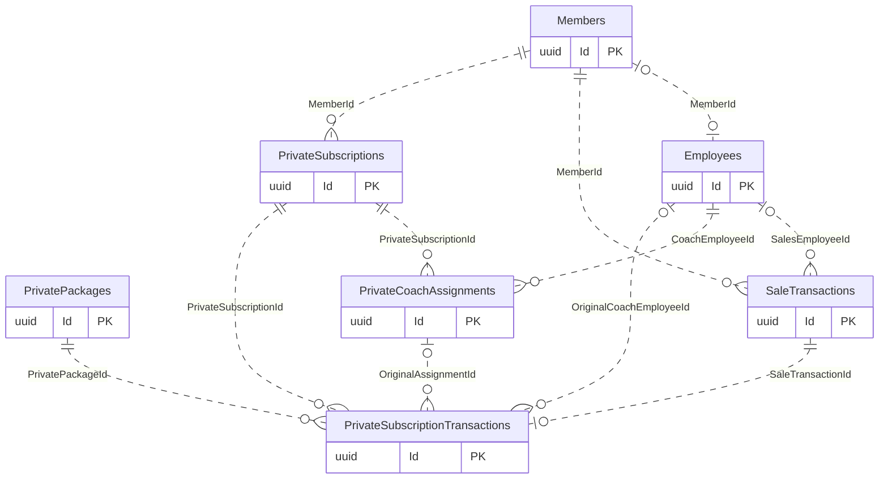
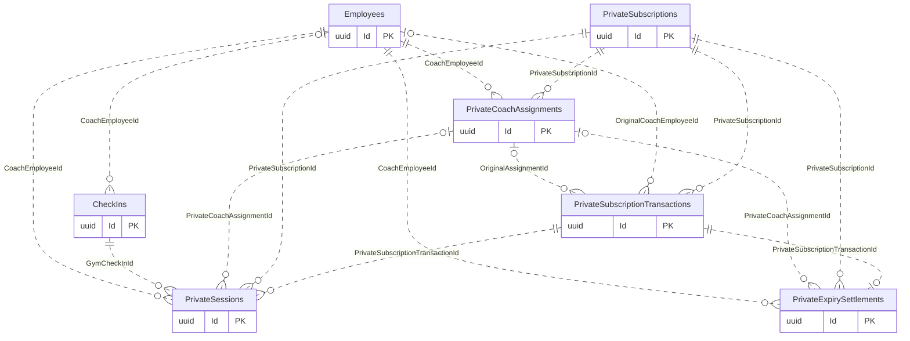
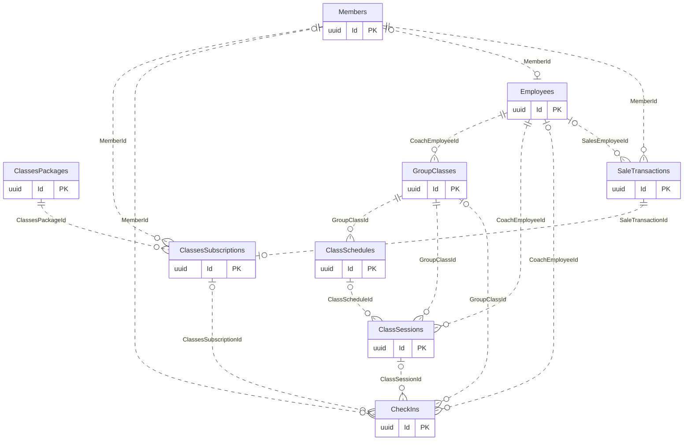
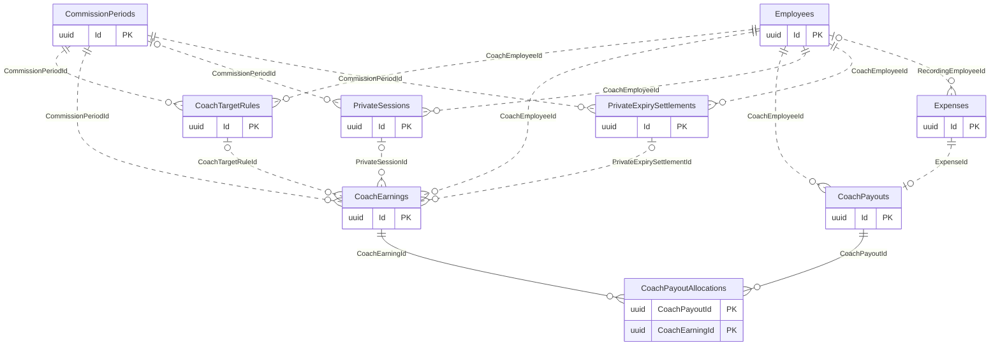
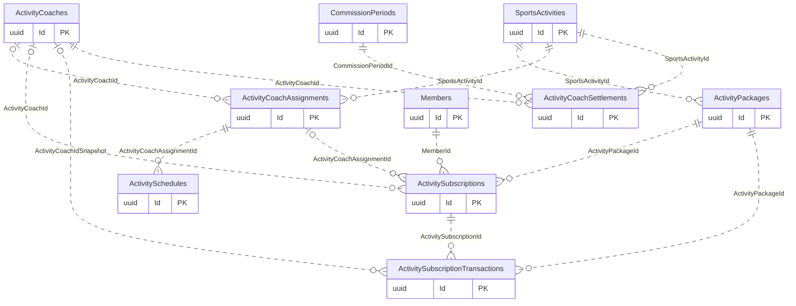
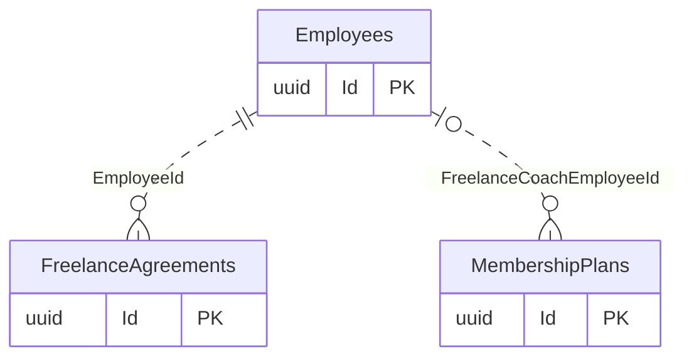

# Private, Classes and Activities

[Navigation](README.md) · [All tables](TABLE_INVENTORY.md) · [Review flags](REVIEW_FLAGS.md)

**24 tables.** Private, shared Classes and older sports activities are distinct entitlement domains. PrivateSessions records real delivery; PrivateExpirySettlements records earnings-only unused-session recognition. CoachEarnings and payout allocations distinguish earned value from payment. Classes compensation remains NotConfigured; class counts/averages come from completed ClassSessions and valid CheckIns.

## Read the diagrams

Only the relationships needed to understand this module are shown. Repeated boundary
boxes belong to other modules and are not counted twice. Routine authorizer/creator
FKs are usually omitted from diagrams; the table cards below list all actual FKs.
Use the [legend](OVERVIEW.md) for optional and one-to-many symbols.

### Private purchase and assignment history

### Actual sessions and separate expiry evidence

### Shared Classes balance and attendance

### Private recognized earnings and payments

### Separate activity domain

### Freelance membership agreements

## Table details

Required/optional means SQL FK nullability, not unconditional permission to omit the
field from an API request; CHECK constraints and services can impose stricter rules.
The category describes its responsibility; history/evidence does not by itself
mean every column is immutable. Exact columns, CHECK SQL and indexes are in [schema.json](schema.json).

### PrivatePackages

Stores Private coaching package prices, session counts and durations.

- **Kind:** Configuration.
- **PK:** `Id` (uuid).
- **FKs:**
  - `BranchId` → [GymBranches](01-auth-employees-branches.md#gymbranches).`Id` (required, many children per parent, delete Restrict).
- **Sources:** [PrivatePackage.cs](../../CampionsSystem.DAL/Entities/PrivatePackage.cs), [PrivatePackageConfiguration.cs](../../CampionsSystem.DAL/Configurations/PrivatePackageConfiguration.cs).

### PrivateSubscriptions

Stores a member's Private entitlement and remaining session balance.

- **Kind:** Core.
- **PK:** `Id` (uuid).
- **FKs:**
  - `BranchId` → [GymBranches](01-auth-employees-branches.md#gymbranches).`Id` (required, many children per parent, delete Restrict).
  - `MemberId` → [Members](02-members-crm.md#members).`Id` (required, many children per parent, delete Restrict).
- **Sources:** [PrivateSubscription.cs](../../CampionsSystem.DAL/Entities/PrivateSubscription.cs), [PrivateSubscriptionConfiguration.cs](../../CampionsSystem.DAL/Configurations/PrivateSubscriptionConfiguration.cs).

### PrivateSubscriptionTransactions

Stores purchased Private batches with sale, original coach and session-value snapshots.

- **Kind:** History / evidence.
- **PK:** `Id` (uuid).
- **FKs:**
  - `OriginalAssignmentId` → [PrivateCoachAssignments](07-private-classes.md#privatecoachassignments).`Id` (optional, many children per parent, delete Restrict).
  - `OriginalCoachEmployeeId` → [Employees](01-auth-employees-branches.md#employees).`Id` (optional, many children per parent, delete Restrict).
  - `PrivatePackageId` → [PrivatePackages](07-private-classes.md#privatepackages).`Id` (required, many children per parent, delete Restrict).
  - `PrivateSubscriptionId` → [PrivateSubscriptions](07-private-classes.md#privatesubscriptions).`Id` (required, many children per parent, delete Restrict).
  - `SaleTransactionId` → [SaleTransactions](04-sales-payments.md#saletransactions).`Id` (required, at most one child per parent, delete Restrict).
- **Unique indexes:** `SaleTransactionId`.
- **Sources:** [PrivateSubscriptionTransaction.cs](../../CampionsSystem.DAL/Entities/PrivateSubscriptionTransaction.cs), [PrivateSubscriptionTransactionConfiguration.cs](../../CampionsSystem.DAL/Configurations/PrivateSubscriptionTransactionConfiguration.cs).

### PrivateCoachAssignments

Stores Private coach allocation and transfer history.

- **Kind:** History / junction.
- **PK:** `Id` (uuid).
- **FKs:**
  - `CoachEmployeeId` → [Employees](01-auth-employees-branches.md#employees).`Id` (required, many children per parent, delete Restrict).
  - `CreatedByUserId` → [AspNetUsers](01-auth-employees-branches.md#aspnetusers).`Id` (required, many children per parent, delete Restrict).
  - `PrivateSubscriptionId` → [PrivateSubscriptions](07-private-classes.md#privatesubscriptions).`Id` (required, many children per parent, delete Restrict).
- **Unique indexes:** `OperationId`; `PrivateSubscriptionId` where `"EndedAt" IS NULL`.
- **Sources:** [PrivateCoachAssignment.cs](../../CampionsSystem.DAL/Entities/PrivateCoachAssignment.cs), [PrivateCoachAssignmentConfiguration.cs](../../CampionsSystem.DAL/Configurations/PrivateCoachAssignmentConfiguration.cs).

### PrivateExpirySettlements

Stores explicitly authorized unused-session earnings entitlement at expiry.

- **Kind:** Evidence.
- **PK:** `Id` (uuid).
- **FKs:**
  - `CoachEmployeeId` → [Employees](01-auth-employees-branches.md#employees).`Id` (required, many children per parent, delete Restrict).
  - `CommissionPeriodId` → [CommissionPeriods](06-commissions.md#commissionperiods).`Id` (required, many children per parent, delete Restrict).
  - `CreatedByUserId` → [AspNetUsers](01-auth-employees-branches.md#aspnetusers).`Id` (optional, many children per parent, delete Restrict).
  - `PrivateCoachAssignmentId` → [PrivateCoachAssignments](07-private-classes.md#privatecoachassignments).`Id` (optional, many children per parent, delete Restrict).
  - `PrivateSubscriptionId` → [PrivateSubscriptions](07-private-classes.md#privatesubscriptions).`Id` (required, many children per parent, delete Restrict).
  - `PrivateSubscriptionTransactionId` → [PrivateSubscriptionTransactions](07-private-classes.md#privatesubscriptiontransactions).`Id` (required, at most one child per parent, delete Restrict).
- **Unique indexes:** `OperationId`; `PrivateSubscriptionTransactionId`.
- **Sources:** [PrivateExpirySettlement.cs](../../CampionsSystem.DAL/Entities/PrivateExpirySettlement.cs), [PrivateExpirySettlementConfiguration.cs](../../CampionsSystem.DAL/Configurations/PrivateExpirySettlementConfiguration.cs).

### PrivateSessions

Stores actual Private sessions, coach attribution and required gym check-in evidence.

- **Kind:** Core / evidence.
- **PK:** `Id` (uuid).
- **FKs:**
  - `CoachEmployeeId` → [Employees](01-auth-employees-branches.md#employees).`Id` (required, many children per parent, delete Restrict).
  - `CommissionPeriodId` → [CommissionPeriods](06-commissions.md#commissionperiods).`Id` (optional, many children per parent, delete Restrict).
  - `CreatedByUserId` → [AspNetUsers](01-auth-employees-branches.md#aspnetusers).`Id` (required, many children per parent, delete Restrict).
  - `GymCheckInId` → [CheckIns](03-subscriptions-check-in.md#checkins).`Id` (required, many children per parent, delete Restrict).
  - `PrivateCoachAssignmentId` → [PrivateCoachAssignments](07-private-classes.md#privatecoachassignments).`Id` (optional, many children per parent, delete Restrict).
  - `PrivateSubscriptionId` → [PrivateSubscriptions](07-private-classes.md#privatesubscriptions).`Id` (required, many children per parent, delete Restrict).
  - `PrivateSubscriptionTransactionId` → [PrivateSubscriptionTransactions](07-private-classes.md#privatesubscriptiontransactions).`Id` (required, many children per parent, delete Restrict).
- **Unique indexes:** `GymCheckInId` where `"OperationId" IS NOT NULL`; `OperationId`; `PrivateSubscriptionTransactionId, SessionNumber` where `"OperationId" IS NOT NULL`.
- **Sources:** [PrivateSession.cs](../../CampionsSystem.DAL/Entities/PrivateSession.cs), [PrivateSessionConfiguration.cs](../../CampionsSystem.DAL/Configurations/PrivateSessionConfiguration.cs).

### ClassesPackages

Stores shared Classes package prices, session counts and durations.

- **Kind:** Configuration.
- **PK:** `Id` (uuid).
- **FKs:**
  - `BranchId` → [GymBranches](01-auth-employees-branches.md#gymbranches).`Id` (required, many children per parent, delete Restrict).
- **Unique indexes:** `BranchId, Name`.
- **Sources:** [ClassesPackage.cs](../../CampionsSystem.DAL/Entities/ClassesPackage.cs), [ClassesPackageConfiguration.cs](../../CampionsSystem.DAL/Configurations/ClassesPackageConfiguration.cs).

### ClassesSubscriptions

Stores purchased Classes balances shared across class types.

- **Kind:** Core / evidence.
- **PK:** `Id` (uuid).
- **FKs:**
  - `BranchId` → [GymBranches](01-auth-employees-branches.md#gymbranches).`Id` (required, many children per parent, delete Restrict).
  - `ClassesPackageId` → [ClassesPackages](07-private-classes.md#classespackages).`Id` (required, many children per parent, delete Restrict).
  - `MemberId` → [Members](02-members-crm.md#members).`Id` (required, many children per parent, delete Restrict).
  - `SaleTransactionId` → [SaleTransactions](04-sales-payments.md#saletransactions).`Id` (required, at most one child per parent, delete Restrict).
- **Unique indexes:** `SaleTransactionId`.
- **Sources:** [ClassesPackage.cs](../../CampionsSystem.DAL/Entities/ClassesPackage.cs), [ClassesPackageConfiguration.cs](../../CampionsSystem.DAL/Configurations/ClassesPackageConfiguration.cs).

### GroupClasses

Stores class types such as Yoga or Zumba.

- **Kind:** Configuration.
- **PK:** `Id` (uuid).
- **FKs:**
  - `BranchId` → [GymBranches](01-auth-employees-branches.md#gymbranches).`Id` (required, many children per parent, delete Restrict).
  - `CoachEmployeeId` → [Employees](01-auth-employees-branches.md#employees).`Id` (required, many children per parent, delete Restrict).
- **Sources:** [GroupClass.cs](../../CampionsSystem.DAL/Entities/GroupClass.cs), [GroupClassConfiguration.cs](../../CampionsSystem.DAL/Configurations/GroupClassConfiguration.cs).

### ClassSchedules

Stores recurring timetable definitions for class types.

- **Kind:** Configuration.
- **PK:** `Id` (uuid).
- **FKs:**
  - `GroupClassId` → [GroupClasses](07-private-classes.md#groupclasses).`Id` (required, many children per parent, delete Restrict).
- **Sources:** [ClassSchedule.cs](../../CampionsSystem.DAL/Entities/ClassSchedule.cs), [ClassScheduleConfiguration.cs](../../CampionsSystem.DAL/Configurations/ClassScheduleConfiguration.cs).

### ClassSessions

Stores dated class occurrences, assigned coaches and completion state.

- **Kind:** Core / history.
- **PK:** `Id` (uuid).
- **FKs:**
  - `BranchId` → [GymBranches](01-auth-employees-branches.md#gymbranches).`Id` (required, many children per parent, delete Restrict).
  - `BusinessDayId` → [BusinessDays](05-shifts-vault-expenses.md#businessdays).`Id` (optional, many children per parent, delete Restrict).
  - `ClassScheduleId` → [ClassSchedules](07-private-classes.md#classschedules).`Id` (optional, many children per parent, delete Restrict).
  - `CoachEmployeeId` → [Employees](01-auth-employees-branches.md#employees).`Id` (required, many children per parent, delete Restrict).
  - `CreatedByUserId` → [AspNetUsers](01-auth-employees-branches.md#aspnetusers).`Id` (optional, many children per parent, delete Restrict).
  - `GroupClassId` → [GroupClasses](07-private-classes.md#groupclasses).`Id` (required, many children per parent, delete Restrict).
- **Unique indexes:** `OperationId`.
- **Sources:** [ClassSession.cs](../../CampionsSystem.DAL/Entities/ClassSession.cs), [ClassSessionConfiguration.cs](../../CampionsSystem.DAL/Configurations/ClassSessionConfiguration.cs).

### SportsActivities

Stores the separate sports/activity catalog.

- **Kind:** Configuration.
- **PK:** `Id` (uuid).
- **FKs:**
  - `BranchId` → [GymBranches](01-auth-employees-branches.md#gymbranches).`Id` (required, many children per parent, delete Restrict).
- **Sources:** [SportsActivity.cs](../../CampionsSystem.DAL/Entities/SportsActivity.cs), [SportsActivityConfiguration.cs](../../CampionsSystem.DAL/Configurations/SportsActivityConfiguration.cs).

### ActivityPackages

Stores purchasable activity packages and their access rules.

- **Kind:** Configuration.
- **PK:** `Id` (uuid).
- **FKs:**
  - `SportsActivityId` → [SportsActivities](07-private-classes.md#sportsactivities).`Id` (required, many children per parent, delete Restrict).
- **Sources:** [ActivityPackage.cs](../../CampionsSystem.DAL/Entities/ActivityPackage.cs), [ActivityPackageConfiguration.cs](../../CampionsSystem.DAL/Configurations/ActivityPackageConfiguration.cs).

### ActivitySchedules

Stores recurring timetable definitions for sports activities.

- **Kind:** Configuration.
- **PK:** `Id` (uuid).
- **FKs:**
  - `ActivityCoachAssignmentId` → [ActivityCoachAssignments](07-private-classes.md#activitycoachassignments).`Id` (required, many children per parent, delete Restrict).
- **Sources:** [ActivitySchedule.cs](../../CampionsSystem.DAL/Entities/ActivitySchedule.cs), [ActivityScheduleConfiguration.cs](../../CampionsSystem.DAL/Configurations/ActivityScheduleConfiguration.cs).

### ActivitySubscriptions

Stores a member's activity entitlement and remaining session balance.

- **Kind:** Core.
- **PK:** `Id` (uuid).
- **FKs:**
  - `ActivityCoachAssignmentId` → [ActivityCoachAssignments](07-private-classes.md#activitycoachassignments).`Id` (optional, many children per parent, delete Restrict).
  - `ActivityCoachId` → [ActivityCoaches](07-private-classes.md#activitycoaches).`Id` (optional, many children per parent, delete Restrict).
  - `ActivityPackageId` → [ActivityPackages](07-private-classes.md#activitypackages).`Id` (required, many children per parent, delete Restrict).
  - `BranchId` → [GymBranches](01-auth-employees-branches.md#gymbranches).`Id` (required, many children per parent, delete Restrict).
  - `MemberId` → [Members](02-members-crm.md#members).`Id` (required, many children per parent, delete Restrict).
- **Sources:** [ActivitySubscription.cs](../../CampionsSystem.DAL/Entities/ActivitySubscription.cs), [ActivitySubscriptionConfiguration.cs](../../CampionsSystem.DAL/Configurations/ActivitySubscriptionConfiguration.cs).

### ActivitySubscriptionTransactions

Stores activity purchase grants and historical coach/rate/value snapshots.

- **Kind:** History / evidence.
- **PK:** `Id` (uuid).
- **FKs:**
  - `ActivityCoachIdSnapshot` → [ActivityCoaches](07-private-classes.md#activitycoaches).`Id` (optional, many children per parent, delete Restrict).
  - `ActivityPackageId` → [ActivityPackages](07-private-classes.md#activitypackages).`Id` (required, many children per parent, delete Restrict).
  - `ActivitySubscriptionId` → [ActivitySubscriptions](07-private-classes.md#activitysubscriptions).`Id` (required, many children per parent, delete Restrict).
  - `SaleTransactionId` → [SaleTransactions](04-sales-payments.md#saletransactions).`Id` (required, many children per parent, delete Restrict).
- **Sources:** [ActivitySubscriptionTransaction.cs](../../CampionsSystem.DAL/Entities/ActivitySubscriptionTransaction.cs), [ActivitySubscriptionTransactionConfiguration.cs](../../CampionsSystem.DAL/Configurations/ActivitySubscriptionTransactionConfiguration.cs).

### ActivityCoaches

Stores internal or external activity coach identities and percentage settings.

- **Kind:** Configuration / core.
- **PK:** `Id` (uuid).
- **FKs:**
  - `EmployeeId` → [Employees](01-auth-employees-branches.md#employees).`Id` (optional, at most one child per parent, delete Restrict).
- **Unique indexes:** `EmployeeId` where `"EmployeeId" IS NOT NULL`.
- **Sources:** [ActivityCoach.cs](../../CampionsSystem.DAL/Entities/ActivityCoach.cs), [ActivityCoachConfiguration.cs](../../CampionsSystem.DAL/Configurations/ActivityCoachConfiguration.cs).

### ActivityCoachAssignments

Stores dated activity coach assignments using the supported coach identity alternatives.

- **Kind:** History / junction.
- **PK:** `Id` (uuid).
- **FKs:**
  - `ActivityCoachId` → [ActivityCoaches](07-private-classes.md#activitycoaches).`Id` (optional, many children per parent, delete Restrict).
  - `CoachEmployeeId` → [Employees](01-auth-employees-branches.md#employees).`Id` (optional, many children per parent, delete Restrict).
  - `SportsActivityId` → [SportsActivities](07-private-classes.md#sportsactivities).`Id` (required, many children per parent, delete Restrict).
- **Sources:** [ActivityCoachAssignment.cs](../../CampionsSystem.DAL/Entities/ActivityCoachAssignment.cs), [ActivityCoachAssignmentConfiguration.cs](../../CampionsSystem.DAL/Configurations/ActivityCoachAssignmentConfiguration.cs).

### ActivityCoachSettlements

Stores finalized activity coach revenue and entitlement snapshots.

- **Kind:** Evidence.
- **PK:** `Id` (uuid).
- **FKs:**
  - `ActivityCoachId` → [ActivityCoaches](07-private-classes.md#activitycoaches).`Id` (required, many children per parent, delete Restrict).
  - `CommissionPeriodId` → [CommissionPeriods](06-commissions.md#commissionperiods).`Id` (required, many children per parent, delete Restrict).
  - `CreatedByUserId` → [AspNetUsers](01-auth-employees-branches.md#aspnetusers).`Id` (required, many children per parent, delete Restrict).
  - `EmployeeId` → [Employees](01-auth-employees-branches.md#employees).`Id` (optional, many children per parent, delete Restrict).
  - `SportsActivityId` → [SportsActivities](07-private-classes.md#sportsactivities).`Id` (required, many children per parent, delete Restrict).
- **Unique indexes:** `CommissionPeriodId, ActivityCoachId, SportsActivityId, Percentage`.
- **Sources:** [ActivityCoachSettlement.cs](../../CampionsSystem.DAL/Entities/ActivityCoachSettlement.cs), [ActivityCoachSettlementConfiguration.cs](../../CampionsSystem.DAL/Configurations/ActivityCoachSettlementConfiguration.cs).

### CoachTargetRules

Stores explicit Private value and Classes attendance-average targets per coach and period.

- **Kind:** Configuration / evidence.
- **PK:** `Id` (uuid).
- **FKs:**
  - `CoachEmployeeId` → [Employees](01-auth-employees-branches.md#employees).`Id` (required, many children per parent, delete Restrict).
  - `CommissionPeriodId` → [CommissionPeriods](06-commissions.md#commissionperiods).`Id` (required, many children per parent, delete Restrict).
  - `CreatedByUserId` → [AspNetUsers](01-auth-employees-branches.md#aspnetusers).`Id` (required, many children per parent, delete Restrict).
- **Unique indexes:** `OperationId`; `CommissionPeriodId, CoachEmployeeId`.
- **Sources:** [CoachEarnings.cs](../../CampionsSystem.DAL/Entities/CoachEarnings.cs), [CoachEarningsConfiguration.cs](../../CampionsSystem.DAL/Configurations/CoachEarningsConfiguration.cs).

### CoachEarnings

Stores recognized funded Private session or expiry entitlement slices and commission amounts.

- **Kind:** Evidence.
- **PK:** `Id` (uuid).
- **FKs:**
  - `BranchId` → [GymBranches](01-auth-employees-branches.md#gymbranches).`Id` (required, many children per parent, delete Restrict).
  - `CoachEmployeeId` → [Employees](01-auth-employees-branches.md#employees).`Id` (required, many children per parent, delete Restrict).
  - `CoachTargetRuleId` → [CoachTargetRules](07-private-classes.md#coachtargetrules).`Id` (optional, many children per parent, delete Restrict).
  - `CommissionPeriodId` → [CommissionPeriods](06-commissions.md#commissionperiods).`Id` (required, many children per parent, delete Restrict).
  - `CreatedByUserId` → [AspNetUsers](01-auth-employees-branches.md#aspnetusers).`Id` (required, many children per parent, delete Restrict).
  - `FinancialMonthId` → [FinancialMonths](08-monthly-closing-payroll.md#financialmonths).`Id` (optional, many children per parent, delete Restrict).
  - `PrivateExpirySettlementId` → [PrivateExpirySettlements](07-private-classes.md#privateexpirysettlements).`Id` (optional, many children per parent, delete Restrict).
  - `PrivateSessionId` → [PrivateSessions](07-private-classes.md#privatesessions).`Id` (optional, many children per parent, delete Restrict).
  - `SaleTransactionId` → [SaleTransactions](04-sales-payments.md#saletransactions).`Id` (required, many children per parent, delete Restrict).
- **Unique indexes:** `CommissionPeriodId, PrivateExpirySettlementId` where `"PrivateExpirySettlementId" IS NOT NULL`; `CommissionPeriodId, PrivateSessionId` where `"PrivateSessionId" IS NOT NULL`.
- **Sources:** [CoachEarnings.cs](../../CampionsSystem.DAL/Entities/CoachEarnings.cs), [CoachEarningsConfiguration.cs](../../CampionsSystem.DAL/Configurations/CoachEarningsConfiguration.cs).

### CoachPayouts

Stores actual partial coach payments linked to an existing paid expense.

- **Kind:** Core / evidence.
- **PK:** `Id` (uuid).
- **FKs:**
  - `AuthorizedByUserId` → [AspNetUsers](01-auth-employees-branches.md#aspnetusers).`Id` (required, many children per parent, delete Restrict).
  - `BranchId` → [GymBranches](01-auth-employees-branches.md#gymbranches).`Id` (required, many children per parent, delete Restrict).
  - `CoachEmployeeId` → [Employees](01-auth-employees-branches.md#employees).`Id` (required, many children per parent, delete Restrict).
  - `ExpenseId` → [Expenses](05-shifts-vault-expenses.md#expenses).`Id` (required, at most one child per parent, delete Restrict).
- **Unique indexes:** `ExpenseId`; `OperationId`.
- **Sources:** [CoachEarnings.cs](../../CampionsSystem.DAL/Entities/CoachEarnings.cs), [CoachEarningsConfiguration.cs](../../CampionsSystem.DAL/Configurations/CoachEarningsConfiguration.cs).

### CoachPayoutAllocations

Links each coach payout to the recognized earnings it settles.

- **Kind:** Evidence / junction.
- **PK:** `CoachPayoutId` (uuid), `CoachEarningId` (uuid).
- **FKs:**
  - `CoachEarningId` → [CoachEarnings](07-private-classes.md#coachearnings).`Id` (required, many children per parent, delete Restrict).
  - `CoachPayoutId` → [CoachPayouts](07-private-classes.md#coachpayouts).`Id` (required, many children per parent, delete Restrict).
- **Sources:** [CoachEarnings.cs](../../CampionsSystem.DAL/Entities/CoachEarnings.cs), [CoachEarningsConfiguration.cs](../../CampionsSystem.DAL/Configurations/CoachEarningsConfiguration.cs).

### FreelanceAgreements

Links freelance coaches to their dedicated membership plans over dated agreements.

- **Kind:** Configuration / history.
- **PK:** `Id` (uuid).
- **FKs:**
  - `BranchId` → [GymBranches](01-auth-employees-branches.md#gymbranches).`Id` (required, many children per parent, delete Restrict).
  - `CreatedByUserId` → [AspNetUsers](01-auth-employees-branches.md#aspnetusers).`Id` (required, many children per parent, delete Restrict).
  - `EmployeeId` → [Employees](01-auth-employees-branches.md#employees).`Id` (required, many children per parent, delete Restrict).
- **Sources:** [FreelanceAgreement.cs](../../CampionsSystem.DAL/Entities/FreelanceAgreement.cs), [FreelanceAgreementConfiguration.cs](../../CampionsSystem.DAL/Configurations/FreelanceAgreementConfiguration.cs).

