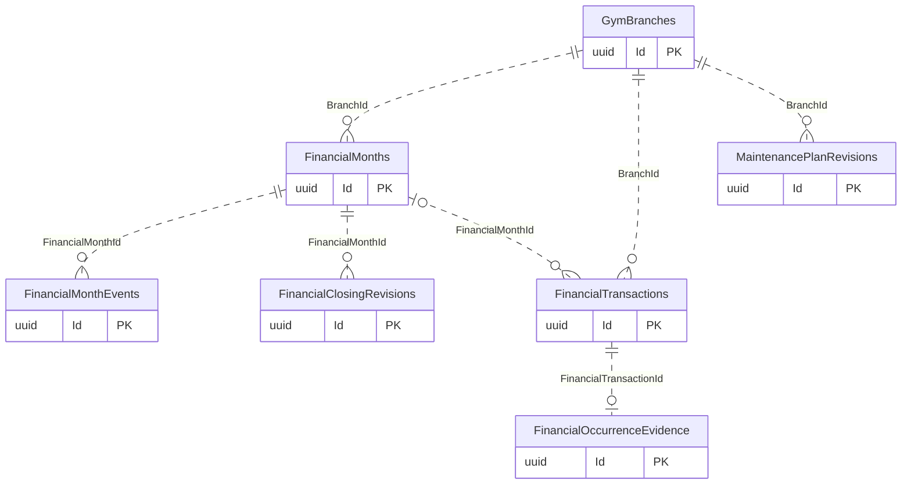
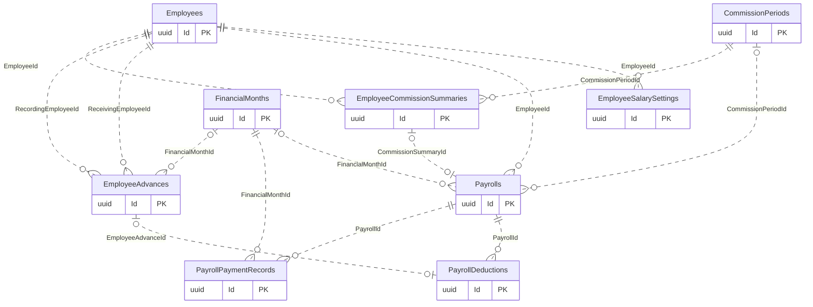

# Monthly Closing and Payroll

[Navigation](README.md) · [All tables](TABLE_INVENTORY.md) · [Review flags](REVIEW_FLAGS.md)

**9 tables.** FinancialMonths is independent of CommissionPeriods and BusinessDays. Frozen revision JSON/workbook bytes preserve earlier reports after reopening. Payrolls represents obligations, while PayrollPaymentRecords records Owner-declared payments without ledger funding. MaintenancePlanRevisions is informational planning, not reserved cash or paid expense.

## Read the diagrams

Only the relationships needed to understand this module are shown. Repeated boundary
boxes belong to other modules and are not counted twice. Routine authorizer/creator
FKs are usually omitted from diagrams; the table cards below list all actual FKs.
Use the [legend](OVERVIEW.md) for optional and one-to-many symbols.

### Month lifecycle and frozen reports

### Employee entitlement versus payment

## Table details

Required/optional means SQL FK nullability, not unconditional permission to omit the
field from an API request; CHECK constraints and services can impose stricter rules.
The category describes its responsibility; history/evidence does not by itself
mean every column is immutable. Exact columns, CHECK SQL and indexes are in [schema.json](schema.json).

### FinancialMonths

Stores independent branch financial reporting periods and lifecycle state.

- **Kind:** Core / configuration.
- **PK:** `Id` (uuid).
- **FKs:**
  - `BranchId` → [GymBranches](01-auth-employees-branches.md#gymbranches).`Id` (required, many children per parent, delete Restrict).
  - `CreatedByUserId` → [AspNetUsers](01-auth-employees-branches.md#aspnetusers).`Id` (required, many children per parent, delete Restrict).
- **Unique indexes:** `BranchId` where `"Status" = 'Open'`; `BranchId, StartDate`.
- **Sources:** [MonthlyFinance.cs](../../CampionsSystem.DAL/Entities/MonthlyFinance.cs), [MonthlyFinanceConfiguration.cs](../../CampionsSystem.DAL/Configurations/MonthlyFinanceConfiguration.cs).

### FinancialMonthEvents

Stores immutable month opening, closing and reopening events.

- **Kind:** Audit / evidence.
- **PK:** `Id` (uuid).
- **FKs:**
  - `ActorUserId` → [AspNetUsers](01-auth-employees-branches.md#aspnetusers).`Id` (required, many children per parent, delete Restrict).
  - `FinancialMonthId` → [FinancialMonths](08-monthly-closing-payroll.md#financialmonths).`Id` (required, many children per parent, delete Restrict).
- **Unique indexes:** `OperationId`.
- **Sources:** [MonthlyFinance.cs](../../CampionsSystem.DAL/Entities/MonthlyFinance.cs), [MonthlyFinanceConfiguration.cs](../../CampionsSystem.DAL/Configurations/MonthlyFinanceConfiguration.cs).

### FinancialClosingRevisions

Stores immutable closing report JSON, exact workbook bytes and revision hashes.

- **Kind:** Evidence.
- **PK:** `Id` (uuid).
- **FKs:**
  - `ActorUserId` → [AspNetUsers](01-auth-employees-branches.md#aspnetusers).`Id` (required, many children per parent, delete Restrict).
  - `FinancialMonthId` → [FinancialMonths](08-monthly-closing-payroll.md#financialmonths).`Id` (required, many children per parent, delete Restrict).
- **Unique indexes:** `FinancialMonthId, Revision`.
- **Sources:** [MonthlyFinance.cs](../../CampionsSystem.DAL/Entities/MonthlyFinance.cs), [MonthlyFinanceConfiguration.cs](../../CampionsSystem.DAL/Configurations/MonthlyFinanceConfiguration.cs).

### EmployeeSalarySettings

Stores effective-dated employee basic salary settings.

- **Kind:** Configuration / history.
- **PK:** `Id` (uuid).
- **FKs:**
  - `CreatedByUserId` → [AspNetUsers](01-auth-employees-branches.md#aspnetusers).`Id` (required, many children per parent, delete Restrict).
  - `EmployeeId` → [Employees](01-auth-employees-branches.md#employees).`Id` (required, many children per parent, delete Restrict).
- **Unique indexes:** `OperationId` where `"OperationId" IS NOT NULL`; `EmployeeId, EffectiveFrom`.
- **Sources:** [EmployeeSalarySetting.cs](../../CampionsSystem.DAL/Entities/EmployeeSalarySetting.cs), [EmployeeSalarySettingConfiguration.cs](../../CampionsSystem.DAL/Configurations/EmployeeSalarySettingConfiguration.cs).

### Payrolls

Stores employee salary or finalized Sales commission payable entitlements.

- **Kind:** Core / evidence.
- **PK:** `Id` (uuid).
- **FKs:**
  - `BranchId` → [GymBranches](01-auth-employees-branches.md#gymbranches).`Id` (required, many children per parent, delete Restrict).
  - `CommissionPeriodId` → [CommissionPeriods](06-commissions.md#commissionperiods).`Id` (optional, many children per parent, delete Restrict).
  - `CommissionSummaryId` → [EmployeeCommissionSummaries](06-commissions.md#employeecommissionsummaries).`Id` (optional, at most one child per parent, delete Restrict).
  - `EmployeeId` → [Employees](01-auth-employees-branches.md#employees).`Id` (required, many children per parent, delete Restrict).
  - `FinancialMonthId` → [FinancialMonths](08-monthly-closing-payroll.md#financialmonths).`Id` (optional, many children per parent, delete Restrict).
  - `PaidByUserId` → [AspNetUsers](01-auth-employees-branches.md#aspnetusers).`Id` (optional, many children per parent, delete Restrict).
  - `PaidFromFinancialAccountId` → [FinancialAccounts](05-shifts-vault-expenses.md#financialaccounts).`Id` (optional, many children per parent, delete Restrict).
  - `RecognizedByUserId` → [AspNetUsers](01-auth-employees-branches.md#aspnetusers).`Id` (optional, many children per parent, delete Restrict).
- **Unique indexes:** `CommissionSummaryId` where `"CommissionSummaryId" IS NOT NULL`; `FinancialMonthId, EmployeeId` where `"FinancialMonthId" IS NOT NULL AND "CommissionSummaryId" IS NULL`.
- **Sources:** [Payroll.cs](../../CampionsSystem.DAL/Entities/Payroll.cs), [PayrollConfiguration.cs](../../CampionsSystem.DAL/Configurations/PayrollConfiguration.cs).

### PayrollDeductions

Stores deductions against payroll entitlements, including linked employee advances.

- **Kind:** Evidence / junction.
- **PK:** `Id` (uuid).
- **FKs:**
  - `CreatedByUserId` → [AspNetUsers](01-auth-employees-branches.md#aspnetusers).`Id` (required, many children per parent, delete Restrict).
  - `EmployeeAdvanceId` → [EmployeeAdvances](05-shifts-vault-expenses.md#employeeadvances).`Id` (optional, at most one child per parent, delete Restrict).
  - `PayrollId` → [Payrolls](08-monthly-closing-payroll.md#payrolls).`Id` (required, many children per parent, delete Restrict).
- **Unique indexes:** `EmployeeAdvanceId` where `"EmployeeAdvanceId" IS NOT NULL`.
- **Sources:** [PayrollDeduction.cs](../../CampionsSystem.DAL/Entities/PayrollDeduction.cs), [PayrollDeductionConfiguration.cs](../../CampionsSystem.DAL/Configurations/PayrollDeductionConfiguration.cs).

### PayrollPaymentRecords

Stores Owner-declared partial employee payments without inferring a funding account.

- **Kind:** Evidence.
- **PK:** `Id` (uuid).
- **FKs:**
  - `ActorUserId` → [AspNetUsers](01-auth-employees-branches.md#aspnetusers).`Id` (required, many children per parent, delete Restrict).
  - `FinancialMonthId` → [FinancialMonths](08-monthly-closing-payroll.md#financialmonths).`Id` (required, many children per parent, delete Restrict).
  - `PayrollId` → [Payrolls](08-monthly-closing-payroll.md#payrolls).`Id` (required, many children per parent, delete Restrict).
- **Unique indexes:** `OperationId`.
- **Sources:** [MonthlyFinance.cs](../../CampionsSystem.DAL/Entities/MonthlyFinance.cs), [MonthlyFinanceConfiguration.cs](../../CampionsSystem.DAL/Configurations/MonthlyFinanceConfiguration.cs).

### MaintenancePlanRevisions

Stores informational recurring maintenance forecasts and their revisions.

- **Kind:** Configuration / history.
- **PK:** `Id` (uuid).
- **FKs:**
  - `ActorUserId` → [AspNetUsers](01-auth-employees-branches.md#aspnetusers).`Id` (required, many children per parent, delete Restrict).
  - `BranchId` → [GymBranches](01-auth-employees-branches.md#gymbranches).`Id` (required, many children per parent, delete Restrict).
- **Unique indexes:** `OperationId`; `PlanId, Revision`.
- **Sources:** [MonthlyFinance.cs](../../CampionsSystem.DAL/Entities/MonthlyFinance.cs), [MonthlyFinanceConfiguration.cs](../../CampionsSystem.DAL/Configurations/MonthlyFinanceConfiguration.cs).

### FinancialOccurrenceEvidence

Stores a separately reported original occurrence time for a ledger movement.

- **Kind:** Evidence.
- **PK:** `Id` (uuid).
- **FKs:**
  - `ActorUserId` → [AspNetUsers](01-auth-employees-branches.md#aspnetusers).`Id` (required, many children per parent, delete Restrict).
  - `FinancialTransactionId` → [FinancialTransactions](05-shifts-vault-expenses.md#financialtransactions).`Id` (required, at most one child per parent, delete Restrict).
- **Unique indexes:** `FinancialTransactionId`; `OperationId`.
- **Sources:** [MonthlyFinance.cs](../../CampionsSystem.DAL/Entities/MonthlyFinance.cs), [MonthlyFinanceConfiguration.cs](../../CampionsSystem.DAL/Configurations/MonthlyFinanceConfiguration.cs).

