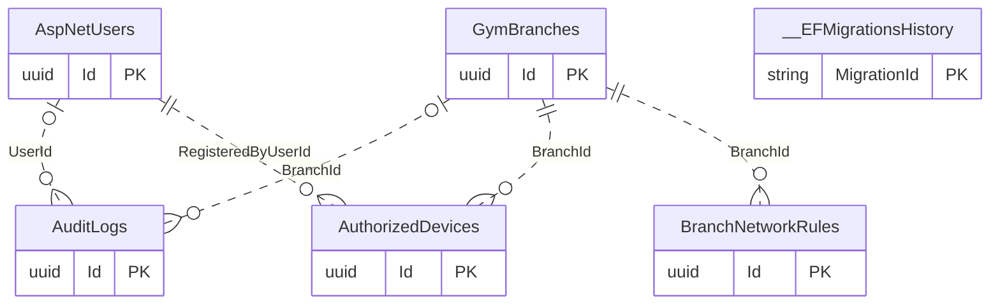
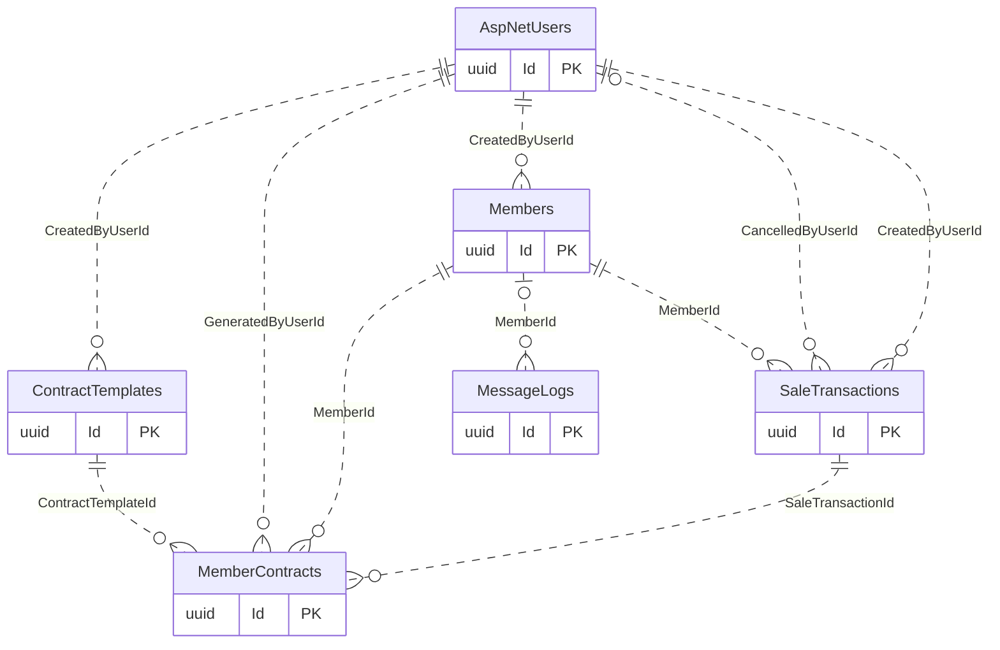

# Supporting Infrastructure

[Navigation](README.md) · [All tables](TABLE_INVENTORY.md) · [Review flags](REVIEW_FLAGS.md)

**7 tables.** These tables support audits, access configuration, contracts, messages and EF rollout metadata. Their presence alone does not establish that every possible device/network/messaging operation is exposed or enabled. AuditLogs.EntityId is a generic record/operation identifier, not a universal relational FK.

## Read the diagrams

Only the relationships needed to understand this module are shown. Repeated boundary
boxes belong to other modules and are not counted twice. Routine authorizer/creator
FKs are usually omitted from diagrams; the table cards below list all actual FKs.
Use the [legend](OVERVIEW.md) for optional and one-to-many symbols.

### Audit and access infrastructure

### Contracts and message records

## Table details

Required/optional means SQL FK nullability, not unconditional permission to omit the
field from an API request; CHECK constraints and services can impose stricter rules.
The category describes its responsibility; history/evidence does not by itself
mean every column is immutable. Exact columns, CHECK SQL and indexes are in [schema.json](schema.json).

### AuditLogs

Stores actors, timestamps and before/after evidence for audited operations.

- **Kind:** Audit.
- **PK:** `Id` (uuid).
- **FKs:**
  - `BranchId` → [GymBranches](01-auth-employees-branches.md#gymbranches).`Id` (optional, many children per parent, delete Restrict).
  - `UserId` → [AspNetUsers](01-auth-employees-branches.md#aspnetusers).`Id` (optional, many children per parent, delete Restrict).
- **Unique indexes:** `EntityId` where `"Action" = 'AccessAdministration.Changed'`.
- **Sources:** [AuditLog.cs](../../CampionsSystem.DAL/Entities/AuditLog.cs), [AuditLogConfiguration.cs](../../CampionsSystem.DAL/Configurations/AuditLogConfiguration.cs).

### AuthorizedDevices

Stores registered device hashes, account ownership and revocation state.

- **Kind:** Configuration.
- **PK:** `Id` (uuid).
- **FKs:**
  - `BranchId` → [GymBranches](01-auth-employees-branches.md#gymbranches).`Id` (required, many children per parent, delete Restrict).
  - `RegisteredByUserId` → [AspNetUsers](01-auth-employees-branches.md#aspnetusers).`Id` (required, many children per parent, delete Restrict).
- **Sources:** [AuthorizedDevice.cs](../../CampionsSystem.DAL/Entities/AuthorizedDevice.cs), [AuthorizedDeviceConfiguration.cs](../../CampionsSystem.DAL/Configurations/AuthorizedDeviceConfiguration.cs).

### BranchNetworkRules

Stores branch network access rule definitions.

- **Kind:** Configuration.
- **PK:** `Id` (uuid).
- **FKs:**
  - `BranchId` → [GymBranches](01-auth-employees-branches.md#gymbranches).`Id` (required, many children per parent, delete Restrict).
- **Sources:** [BranchNetworkRule.cs](../../CampionsSystem.DAL/Entities/BranchNetworkRule.cs), [BranchNetworkRuleConfiguration.cs](../../CampionsSystem.DAL/Configurations/BranchNetworkRuleConfiguration.cs).

### ContractTemplates

Stores versioned contract template text.

- **Kind:** Configuration.
- **PK:** `Id` (uuid).
- **FKs:**
  - `CreatedByUserId` → [AspNetUsers](01-auth-employees-branches.md#aspnetusers).`Id` (required, many children per parent, delete Restrict).
- **Unique indexes:** `Name, Version`.
- **Sources:** [ContractTemplate.cs](../../CampionsSystem.DAL/Entities/ContractTemplate.cs), [ContractTemplateConfiguration.cs](../../CampionsSystem.DAL/Configurations/ContractTemplateConfiguration.cs).

### MemberContracts

Stores generated member contract snapshots and physical archive references.

- **Kind:** History / evidence.
- **PK:** `Id` (uuid).
- **FKs:**
  - `ContractTemplateId` → [ContractTemplates](09-supporting-infrastructure.md#contracttemplates).`Id` (required, many children per parent, delete Restrict).
  - `GeneratedByUserId` → [AspNetUsers](01-auth-employees-branches.md#aspnetusers).`Id` (required, many children per parent, delete Restrict).
  - `MemberId` → [Members](02-members-crm.md#members).`Id` (required, many children per parent, delete Restrict).
  - `SaleTransactionId` → [SaleTransactions](04-sales-payments.md#saletransactions).`Id` (required, many children per parent, delete Restrict).
- **Sources:** [MemberContract.cs](../../CampionsSystem.DAL/Entities/MemberContract.cs), [MemberContractConfiguration.cs](../../CampionsSystem.DAL/Configurations/MemberContractConfiguration.cs).

### MessageLogs

Stores outbound message status and delivery/failure metadata.

- **Kind:** Infrastructure / history.
- **PK:** `Id` (uuid).
- **FKs:**
  - `MemberId` → [Members](02-members-crm.md#members).`Id` (optional, many children per parent, delete Restrict).
- **Sources:** [MessageLog.cs](../../CampionsSystem.DAL/Entities/MessageLog.cs), [MessageLogConfiguration.cs](../../CampionsSystem.DAL/Configurations/MessageLogConfiguration.cs).

### __EFMigrationsHistory

Stores which EF Core migrations have been applied to a database.

- **Kind:** Framework.
- **PK:** `MigrationId` (character varying(150)).
- **FKs:** none.
- **Source:** [reviewed EF migration SQL](../database/InitialCreate.sql); framework metadata, not a DbSet.

