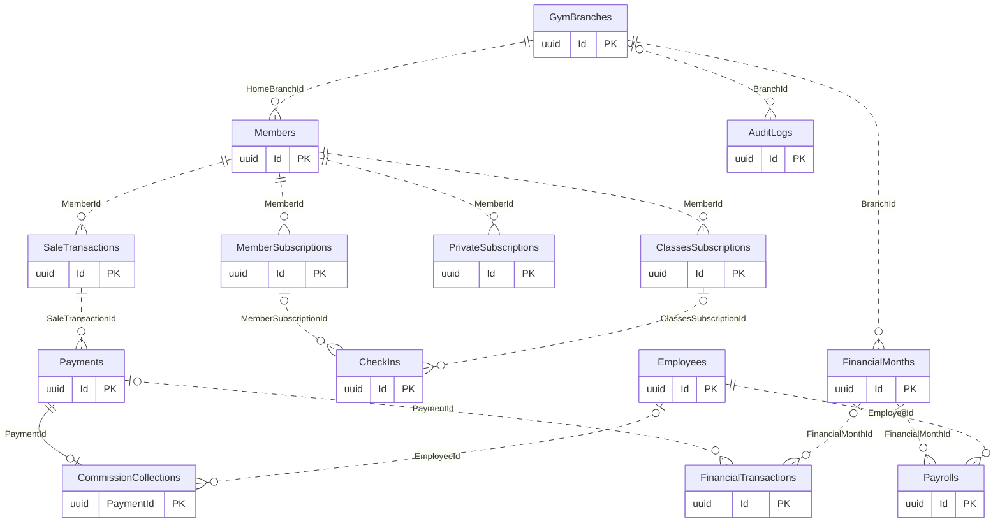

# Main module connections

[Navigation](README.md) · [Inventory](TABLE_INVENTORY.md) · [Data flow](DATA_FLOW.md)

Each box below is an actual table, representing its module; each line is an actual FK.
This intentionally omits most evidence, configuration and actor links. The individual
module pages give fuller diagrams and every table FK. An ERD is not chronological
execution order; use DATA_FLOW.md for that.

Legend: `||` = exactly one parent; `|o / o|` = zero or one; `o{` = zero or many.
Left symbols describe the parent permitted for a child; right symbols describe
children permitted for a parent. PK = primary key; FK = foreign key.
Solid lines identify a child through a FK that is part of its PK; dotted lines are
non-identifying. A parent may have no children even for a required FK. Filtered
uniqueness is reflected as one-to-one only when it applies to every non-null FK.
Other conditional uniqueness is recorded beside the table, not overstated in the ERD.
Delete behavior on cards is the EF setting: Restrict preserves referenced rows;
Cascade removes dependents; ClientSetNull is client-side behavior, not a database
SET NULL promise. SQL nullability does not override API validation or CHECK rules.

Branch and employee nodes represent Authentication/Employees/Branches; members
represent CRM; regular subscriptions/CheckIns represent access; sales/payments and
the financial ledger represent collections; CommissionCollections represents Sales
attribution; Payrolls/FinancialMonths represent closing and obligations; Private and
Classes subscriptions represent coaching access; AuditLogs represents infrastructure.
