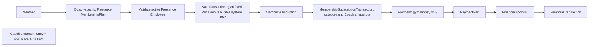
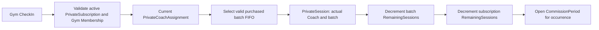
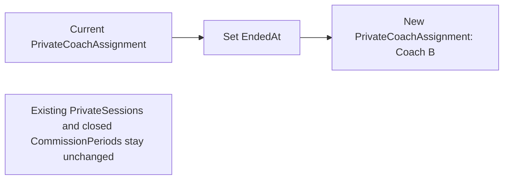
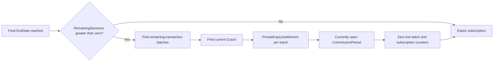
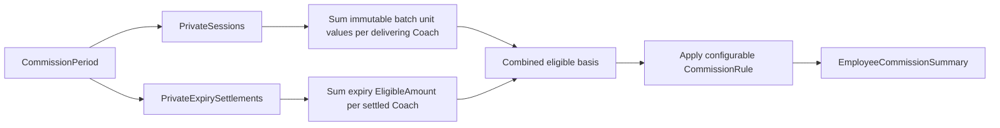

# Purchase, attendance and commission flows

These are specifications for later BLL services; no workflows or triggers are
implemented here. Use existing authorization, branch consistency, idempotency and
ledger validation rules. All related writes in each flow use one database transaction.
Prefer deactivation over deleting products/employees. Historical FKs use Restrict.

## 1. Normal gym membership purchase

Load the active plan; validate member/branch/city and any system Offer. Price is
normal gym selling amount. Snapshot price, category Normal and null freelance
Coach; renewals add a new transaction. PaymentParts sum to money actually received;
post consistent ledger entries. Account balance derives from its ledger.

## 2. Freelance gym membership purchase

1. Load the selected plan and detect Freelance category.
2. Require FreelanceCoachEmployeeId and a currently active Freelance Employee.
3. Use MembershipPlan.Price as the amount due to the gym. Apply only eligible
   system Offers attached to that plan using existing OfferMembershipPlans.
4. Create SaleTransaction, membership/renewal and purchase transaction; snapshot
   PlanCategory and FreelanceCoachEmployeeId independently of future plan edits.
5. Record Payment/PaymentParts and account/ledger posting only for gym money.

Example: plan Price=300; Coach charges 400 or 500 externally. Without a system
Offer, gym SaleTransaction.NetAmount=300 and full Payment.Amount=300. Neither the
external total nor Coach margin is stored as gym revenue or commission. Never
ask reception how much the Coach charged the client. A Coach's personal discount
is outside the system and does not change the gym amount. FreelanceAgreement is
agreement metadata only; no pricing or permanent client ownership table is added.

## 3. Private package purchase

Validate package/member/branch and sale amount. Create immutable purchase facts:
SessionsAdded, DurationDaysAdded, NetAmount, UnitSessionValue, date snapshots and
CreatedAt. Initialize batch RemainingSessions=SessionsAdded; update subscription
totals and end date. Initial assignment has EndedAt=null; renewals preserve current
assignment unless explicitly transferring. Payment follows existing split-payment
and ledger rules. No commission is earned solely from assigning a Coach.

Each batch stores its own unit value: 20 sessions at 100 and a renewal of 10 at
120 are separate batches. Never reprice old batches. UnitSessionValue remains
numeric(18,2); define purchase rounding in BLL rather than repricing delivered
sessions. It is the authoritative value for delivered-session basis; no duplicate
session price is stored. Expiry settlement deliberately snapshots its financial
count and unit value.

## 4. Private session attendance

1. Validate active PrivateSubscription and active Gym Membership.
2. Validate same member/date/branch gym CheckIn.
3. Find assignment with EndedAt=null; require authenticated Coach is that Coach.
4. Lock the subscription; select eligible batch with RemainingSessions>0,
   ordered by CreatedAt then Id (FIFO). Validate it belongs to this subscription.
5. Create exactly one PrivateSession referencing subscription, batch, delivering
   Coach, CheckIn, user and open CommissionPeriod covering SessionAt.
6. Decrement batch and subscription counters by one; save all writes atomically.

Do not use triggers. Deduplicate requests; serialize competing attendance/transfer/
expiry/renewal operations. Do not consume a settled batch or reuse a CheckIn to
accidentally duplicate an attendance. Delivered basis = batch.UnitSessionValue.
If the relevant period is closed, use an authorized correction policy rather
than silently attaching backdated delivery to a different period.

## 5. Private Coach transfer

Lock subscription; find current assignment, set EndedAt, then create new Coach
assignment with AssignedAt/reason/created user. Flush the old row before inserting
the new row to respect the partial unique index; both saves belong to the SAME
transaction. Validate active eligible new Coach. Transfer is allowed regardless
of earlier period closure. Existing sessions, their delivering Coach, batch,
period and finalized earnings remain unchanged. Future sessions use Coach B;
there is no automatic movement of already-earned money.

## 6. Private subscription expiration

Under the same subscription lock/transaction, recheck final EndDate and no renewal.
If no sessions remain, simply mark Expired. Otherwise find current assignment and
all batches with RemainingSessions>0. For each create a settlement snapshot with
RemainingSessions, UnitSessionValue and EligibleAmount=count*unit value, current
Coach, open period at expiry/settlement, SettledAt and nullable initiating user
(for automation). Verify batch totals equal subscription total; do not guess if
inconsistent. Zero live counters and mark Expired in the same transaction.

Unique PrivateSubscriptionTransactionId prevents double settlement. Retry safely:
never recreate settlements for an already expired/settled batch. Preserve every
session, assignment and settlement. Missing current Coach/open period blocks the
whole settlement for review/retry. Final expiry uses branch-local EndDate semantics.

Example: 20 sessions at 100; Coach A delivered 6 (basis 600), Coach B delivered 10
(basis 1000). At expiry 4 unused sessions add 400 to current Coach B: total basis
A=600, B=1400. Expiry does not change the periods of the 16 delivered sessions.

## 7. Private commission calculation

Group sessions and settlements by their own CommissionPeriodId/CoachEmployeeId.
Resolve existing effective-dated CommissionRules and employee overrides; apply
configured rates/methods and save the existing summary snapshots. Eligible basis
1000 with AppliedRate=60 percent yields final commission 600. Configure 100 percent
in CommissionRule if needed; never hardcode percentages into Private entities.
Closing a period finalizes its history. A later transfer does not recalculate it.
