# Purchase, attendance and commission flows

The numbered purchase/attendance diagrams are business specifications. The Member
Management section below describes the implemented registration and ownership workflows. Use existing authorization, branch consistency, idempotency and
ledger validation rules. All related writes in each flow use one database transaction.
Prefer deactivation over deleting products/employees. Historical FKs use Restrict.

## 1. Normal gym membership purchase

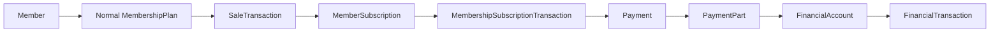

Load the active plan; validate member/branch/city and any system Offer. Price is
normal gym selling amount. Snapshot price, category Normal and null freelance
Coach; renewals add a new transaction. PaymentParts sum to money actually received;
post consistent ledger entries. Account balance derives from its ledger.

## 2. Freelance gym membership purchase

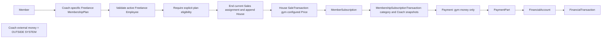

1. Load the selected plan and detect Freelance category.
2. Require FreelanceCoachEmployeeId and a currently active Freelance Employee.
3. Require explicit plan eligibility. End an existing current Sales assignment and
   append House, preserving all previous assignments/sales. Use MembershipPlan.Price
   as the gym amount due. The focused purchase service does not accept discounts;
   only a future validated system Offer workflow may adjust that amount.
4. Create SaleTransaction, membership/renewal and purchase transaction; snapshot
   PlanCategory and FreelanceCoachEmployeeId independently of future plan edits.
   Set SalesAttributionSnapshot=House; SalesEmployeeId and SaleCategory are null.
5. Record Payment/PaymentParts and account/ledger posting only for gym money.

Example: plan Price=300; Coach charges 400 or 500 externally. Without a system
Offer, gym SaleTransaction.NetAmount=300 and full Payment.Amount=300. Neither the
external total nor Coach margin is stored as gym revenue or commission. Never
ask reception how much the Coach charged the client. A Coach's personal discount
is outside the system and does not change the gym amount. FreelanceAgreement is
agreement metadata only; no pricing or permanent client ownership table is added.

## 3. Private package purchase

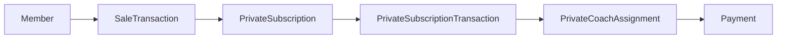

Validate package/member/branch and sale amount. Create immutable purchase facts:
SessionsAdded, DurationDaysAdded, NetAmount, UnitSessionValue, date snapshots and
CreatedAt. Initialize batch RemainingSessions=SessionsAdded; update subscription
totals and end date. Initial assignment has EndedAt=null; renewals preserve current
assignment unless explicitly transferring. Payment follows existing split-payment
and ledger rules. No commission is earned solely from assigning a Coach.

Each batch stores its own unit value: 20 sessions at 100 and a renewal of 10 at
120 are separate batches. Never reprice old batches. UnitSessionValue remains
numeric(18,2); define purchase rounding in BLL rather than repricing delivered
sessions. It is the authoritative value for delivered-session basis; no duplicate
session price is stored. Expiry settlement deliberately snapshots its financial
count and unit value.

## 4. Private session attendance

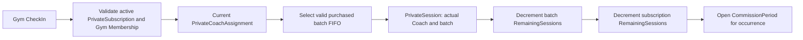

1. Validate active PrivateSubscription and active Gym Membership.
2. Validate same member/date/branch gym CheckIn.
3. Find assignment with EndedAt=null; require authenticated Coach is that Coach.
4. Lock the subscription; select eligible batch with RemainingSessions>0,
   ordered by CreatedAt then Id (FIFO). Validate it belongs to this subscription.
5. Create exactly one PrivateSession referencing subscription, batch, delivering
   Coach, CheckIn, user and open CommissionPeriod covering SessionAt.
6. Decrement batch and subscription counters by one; save all writes atomically.

Do not use triggers. Deduplicate requests; serialize competing attendance/transfer/
expiry/renewal operations. Do not consume a settled batch or reuse a CheckIn to
accidentally duplicate an attendance. Delivered basis = batch.UnitSessionValue.
If the relevant period is closed, use an authorized correction policy rather
than silently attaching backdated delivery to a different period.

## 5. Private Coach transfer

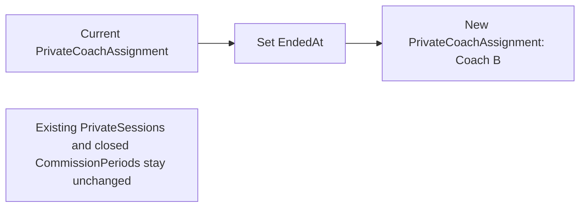

Lock subscription; find current assignment, set EndedAt, then create new Coach
assignment with AssignedAt/reason/created user. Flush the old row before inserting
the new row to respect the partial unique index; both saves belong to the SAME
transaction. Validate active eligible new Coach. Transfer is allowed regardless
of earlier period closure. Existing sessions, their delivering Coach, batch,
period and finalized earnings remain unchanged. Future sessions use Coach B;
there is no automatic movement of already-earned money.

## 6. Private subscription expiration

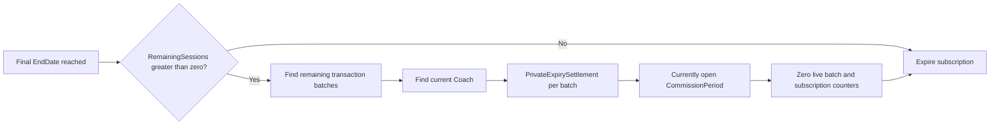

Under the same subscription lock/transaction, recheck final EndDate and no renewal.
If no sessions remain, simply mark Expired. Otherwise find current assignment and
all batches with RemainingSessions>0. For each create a settlement snapshot with
RemainingSessions, UnitSessionValue and EligibleAmount=count*unit value, current
Coach, open period at expiry/settlement, SettledAt and nullable initiating user
(for automation). Verify batch totals equal subscription total; do not guess if
inconsistent. Zero live counters and mark Expired in the same transaction.

Unique PrivateSubscriptionTransactionId prevents double settlement. Retry safely:
never recreate settlements for an already expired/settled batch. Preserve every
session, assignment and settlement. Missing current Coach/open period blocks the
whole settlement for review/retry. Final expiry uses branch-local EndDate semantics.

Example: 20 sessions at 100; Coach A delivered 6 (basis 600), Coach B delivered 10
(basis 1000). At expiry 4 unused sessions add 400 to current Coach B: total basis
A=600, B=1400. Expiry does not change the periods of the 16 delivered sessions.

## 7. Private commission calculation

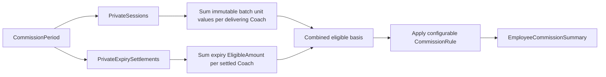

Group sessions and settlements by their own CommissionPeriodId/CoachEmployeeId.
Resolve existing effective-dated CommissionRules and employee overrides; apply
configured rates/methods and save the existing summary snapshots. Eligible basis
1000 with AppliedRate=60 percent yields final commission 600. Configure 100 percent
in CommissionRule if needed; never hardcode percentages into Private entities.
Closing a period finalizes its history. A later transfer does not recalculate it.

## 8. Sports activity purchase, revenue and settlement

```mermaid
flowchart LR
    M[Member] --> P[Select ActivityPackage]
    P --> C[Select active assigned ActivityCoach]
    C --> U[ActivitySubscription - independent of Gym access]
    U --> S[Create activity SaleTransaction]
    S --> B[Purchase batch - snapshot coach and percentage]
    B --> Pay[Receive Payment and PaymentParts]
    Pay --> R[Count each completed Payment once in its period]
    R --> Refund[Subtract linked eligible refunds]
    Refund --> Rate[Apply batch percentage - no targets]
    Rate --> Report[Coach revenue report]
    Report --> Final[Explicit closed-period snapshot]
    Final --> Internal[Internal EmployeeCommissionSummary]
    Final --> External[External coach amount owed - no Employee payroll]
```

The purchase service atomically creates/renews the subscription, creates the sale,
records batch attribution and audits coach selection. It does not receive payments
or grant Gym membership. New subscriptions are Scheduled; payment/access activation
remains the payment workflow's responsibility. Renewals can select a new assigned
coach for future batches; previous batches/installments retain their original coach/rate.

Report rows group by coach/activity/**purchase percentage**; multiple configured
rates may therefore yield multiple rows. Subscribers are distinct paid members per
row. Eligible revenue is completed Payment.Amount minus linked refunds, not list
price or the sum of joined payment/part rows. Validate parts total. Round each grouped
entitlement to two places, midpoint away from zero. Period intervals are [start,end).

Finalize explicitly after period close, with its final EndAt and reconciled records.
Internal snapshots feed one EmployeeCommissionSummary per employee/activity;
external snapshots remain separate. No external payment/ledger engine is added.
Never recalculate finalized snapshots automatically, including when a period is
reopened. Later refunds require a separately authorized adjustment, not history edits.

## 9. Actual class attendance — statistics only

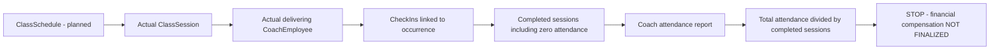

Scheduled/cancelled sessions are excluded. A completed empty session contributes
one to the denominator and zero to the numerator. The session's actual coach wins
over GroupClass/planned coach. Unique member/session attendance avoids duplicate
counts. Legacy class CheckIns without session links are excluded until reconciled;
no fake occurrences or manual attendance totals are created.

## 10. Freelance plan configuration, eligibility and House sale

```mermaid
flowchart LR
    Plan[Create Freelance MembershipPlan] --> Coach[Assign active Freelance Employee]
    Coach --> Price[Set MembershipPlan.Price - gym money]
    Price --> Eligible[Explicitly add eligible Members]
    Eligible --> Validate[Validate eligibility in BLL on every purchase or renewal]
    Validate --> History[End current Sales assignment and append House]
    History --> Purchase[Create membership and immutable coach/plan snapshots]
    Purchase --> Sale[House sale - no Sales employee or category]
    Sale --> Stop[No SalesNew or SalesRenewal commission]
```

Removing eligibility affects future purchases only. Historical membership/sale
snapshots survive plan edits and eligibility removal. One member may be listed on
multiple plans; no permanent global coach lock exists. No coach margin, external
client charge, Freelance settlement pricing engine or permanent client table is added.

## 11. Business day — explicit operational date

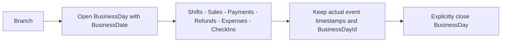

After midnight, operations may continue referencing the still-open prior BusinessDate.
No timestamp is overwritten. Purchase batches derive BusinessDay through their sale;
parts derive it through their payment/refund. Ledger adjustments and actual class sessions
also have explicit optional day links. Legacy unknown links remain null for reconciliation.
Future BLL performs assignment/branch checks; this alignment implements no day workflow.

## 12. Employee leave and shift replacement — storage ready

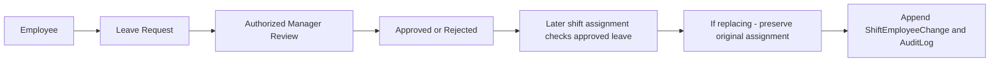

No manager hierarchy or approval/shift API is implemented by this schema alignment.

## 13. Class, activity and Freelance facts ready for vertical features

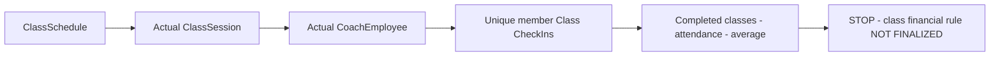

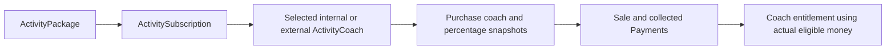

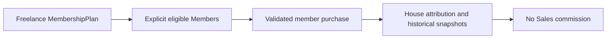

These reuse existing schema facts and any previously implemented feature code. This
final alignment adds no purchase, attendance, report, financial or authorization service.

Latest Private transfer calculation: preserve delivered/expiry monetary basis, determine
transferred-client context from assignment history, then apply the future BLL 50% rule
for transferred-client work and expiry. Existing ordinary CommissionRule behavior applies
to other Private work; no database trigger hardcodes the transfer percentage.

## Membership benefit configuration, snapshots and usage

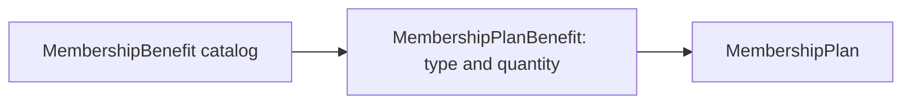

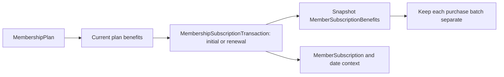

Future purchase BLL copies code, name, grant type and granted quantity atomically.
Later configuration edits leave existing snapshots unchanged. Renewals copy the new
configuration into a new batch; no automatic snapshot creation is implemented yet.

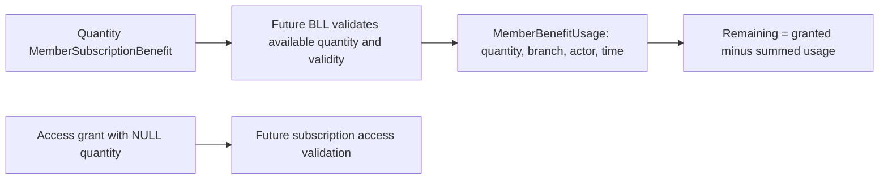

Usage is not a payment or sale. Carryover, expiration, FIFO and reset rules remain
**BUSINESS RULE NOT FINALIZED**. This alignment only stores the required facts.

## Branch context, transfer and future boundaries

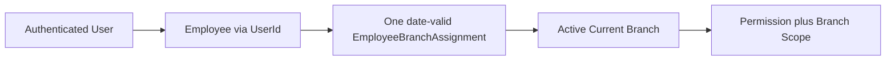

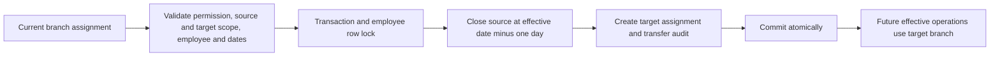

Historical transaction/attendance/shift branches remain unchanged. Future transfers
switch context on their effective calendar date; no automatic dependent-module reassignment.

```mermaid
flowchart LR
    Member[Member from any home branch] --> Sub[Shared active Subscription]
    Sub --> Eligible[Verify target branch eligibility]
    Eligible --> Check[Future CheckIn at actual target branch]
    Check --> Sessions[SessionBased deducts one shared session]
    Check --> Unlimited[Unlimited deducts no session quantity]
```

This future member lookup exposes only required operational data, not branch financials.
It does not transfer the member's home branch; no check-in feature is added here.

```mermaid
flowchart LR
    Money[Money received at Branch B] --> Sale[Future Sale Branch B]
    Sale --> Payment[Payment Branch B]
    Payment --> Ledger[Ledger Branch B]
    Spend[Money spent at Branch B] --> Expense[Expense Branch B]
```

Future finance ownership follows actual receiving/spending branch, not member registration
or the employee's later current assignment. No financial workflow is implemented here.

## Employee management

```mermaid
flowchart LR
    U[Authenticated user] --> P[Employees.View or Employees.Manage]
    P --> S[Validate branch scope]
    S --> E[Employee profile and current assignment]
    E --> L[List / details / totalCount]
    S --> C[Create employee without login account]
    C --> A[Optional existing initial branch assignment service]
    A --> T[Atomic employee + assignment + audit]
    S --> M[Profile update or status change]
    M --> R[Employee row lock shared with branch transfers]
    R --> H[Preserve historical records and save audit]
```

Employees remain separate from Identity accounts. Ended employment uses the existing
Resigned status and TerminationDate; no payroll, salary or account workflow is added.

## FREE TRIAL FLOW

Guest -> Gym / Member Invitation -> Available Invitation -> future CheckIn
redemption -> Redeemed -> no future free trial.

The invitation does not require a Member. Future redemption creates a Trial
CheckIn at the actual visit branch and links RedeemedCheckInId. It produces no
SaleTransaction, Payment or FinancialTransaction. BLL must validate identity,
availability and cross-record consistency inside a transaction; unique indexes
arbitrate duplicate redemption. No redemption workflow is implemented here.

## MEMBER INVITATION BENEFIT — FUTURE

MemberSubscriptionBenefit -> GuestInvitation -> future MemberBenefitUsage ->
Guest CheckIn.

SourceSubscriptionBenefitId preserves the original grant batch. Future BLL
validates inviter ownership, benefit kind, remaining quantity and consumption
timing, and records usage atomically. The invitation FK does not consume benefits.

## HOUSE CUSTOMER FLOW — FUTURE

House Member -> inactive for configured period -> manager report -> assign to
Sales -> MemberSalesAssignment history.

Derive inactivity from subscription end, last check-in and last sale/renewal.
HouseClientInactiveAfterDays is a proposed future configurable threshold; there
is no general settings subsystem to extend now. End the previous assignment and
create the new assignment; preserve history. Freelance eligibility remains
MembershipPlanEligibleMembers, independent of future normal-plan purchases.

## EMPLOYEE GYM ACCESS — FUTURE

Employee -> Member Profile -> Employee Membership -> Unlimited Gym Access

When Employee is Active, a Member profile exists and there is no open employee
membership, future BLL creates a Scheduled/Active Unlimited subscription with
EmployeeId and null EndDate using an Employee plan. No financial rows are created.

Scan Employee Member QR -> find Employee Membership -> verify current Active
employment and dates -> normal Gym CheckIn -> no session deduction.

Employee suspended or permanently leaves -> employee membership closes
(Expired/Cancelled, actual EndDate) -> old period retained.

Employee returns -> new Employee Membership period; never reopen the old period.
The existing Resigned + TerminationDate representation covers permanent departure.
Lifecycle, linking and access verification are deferred until Member Management/
Subscription services; status changes do not automatically create/close periods now.

## Member Management (implemented)

```mermaid
flowchart LR
    Sales[Authenticated eligible Sales] --> Normal[NormalSales registration]
    Normal --> Branch[Select active registration branch]
    Branch --> Code[Atomic branch ClientCode allocation]
    Code --> Member[Member profile and normalized phone]
    Member --> Owner[Current Sales assignment to authenticated employee]
    Owner --> Audit[Audit and transaction commit]
```

Cross-branch referral: Sales Ahmed stays in Branch A → customer chooses Branch B →
registration origin B → ClientCode from B → owner Ahmed from A. Requires the specific
referral capability. It grants no general B member/employee/financial access. Future
revenue is attributed to B and eligible commission to Ahmed, with separate per-branch
target buckets; no commission or purchase logic is implemented by registration.

```mermaid
flowchart LR
    Coach[Freelance special offer] --> Register[Authorized FreelanceHouse registration]
    Register --> Profile[Member and plan eligibility]
    Profile --> House[No Sales assignment: House]
    House --> Manager[Authorized management assignment]
    Manager --> Sales[Append current Sales assignment]
    Sales --> Reassign[Close current row and append successor]
    Sales --> Return[Close current row: return to House]
```

Freelance registration creates no subscription, payment, sale or check-in. A normal
management-created registration must explicitly select eligible Sales; a normal Sales
registration resolves the actor. Reassignment/House return preserve all prior rows.
Profile edits cannot change registration origin, identifiers or ownership. Status
Active/Inactive preserves all related history. See [Member Management](../MEMBER_MANAGEMENT.md).

## CRM / Leads (2026-10-08)

Manager -> create/bulk phone-only Leads -> assign eligible branch Sales -> My Leads
-> append contact -> next follow-up. Reassignment closes the old row and preserves
history. Lost is historical; authorized management can retry without recreating.

Walk-in lookup: normalized phone -> existing Member -> existing Lead -> NotFound.
Existing Member ownership remains. Existing Lead owned by Ahmed -> authorized
conversion at Mohamed's desk -> Member owner Ahmed. Totally new walk-in -> existing
NormalSales Member workflow -> current eligible Sales owner. Public registration
cannot bypass an existing Lead; inaccessible duplicate details remain private.

Cross-branch conversion: Lead/Sales A -> destination registration B -> B ClientCode
-> owner Sales A; employee stays A. No wider B scope. Future revenue B and future
commission A+B stay distinct per-branch buckets, with no calculations here.

Explicit Freelance conversion -> eligible plan -> House -> no Sales assignment;
old Lead ownership and exception are audited. Legacy import must preserve old Sales
ownership or original House state; import itself is future work.

Member task opened explicitly -> current owner queue, including owned cross-branch
Members. No owner -> House management queue -> existing Member assignment workflow
-> new owner's queue. Reassignment dynamically moves current work. Automatic Member
status/expiry/attendance task generation is not wired; internal CRM lifecycle method
is provided for future callers. Full detail: [CRM management](../CRM_LEADS.md).

## Employee movement and operational Lead conversion

Employee A → B changes employment branch assignment only: existing Members and Leads
remain owned by that employee, and My Leads/My Follow-ups retain their old-branch work.
New B Leads may be distributed to them; new assignments still validate current branch.
No registration branch, Lead operational branch or historical transaction is rewritten.

Non-active employment → close current Sales assignment rows → Members become House
and Leads become unassigned redistribution work → management explicitly assigns later.
History remains; reactivating employment does not restore closed assignments.

Lead owner Ahmed → customer received by authorized Ali → Ali converts in his permitted
registration branch → Member owner Ahmed; creation/conversion audit actor Ali. Conversion
requires Leads.Convert + Members.Create and active employment, not Members.AssignSales.
Registering outside Ali's current branch requires Members.CreateCrossBranch. Source
Lead branch does not grant browsing or finance scope. Future commission bucket remains
employee + actual sale/payment branch, independently of employee's current branch.

## Membership Plan templates (2026-10-09)

Branch manager → own current Branch plan → future purchase → future subscription.
Global management → shared categories/benefits → branch managers select active items.
Freelance Coach → fixed gym-price plan → selected eligible Members (any registration
branch) → existing ownership unchanged; explicit FreelanceHouse remains House.
Employee → internal free Unlimited template → employment-bound grant workflow later.
Plan benefits → future purchase snapshot → MemberSubscriptionBenefits.
Template edit/deactivation → future configuration only → historical snapshots remain.
City access configuration → future Check-In validation; BranchId → administration.
See [Membership Plans](../MEMBERSHIP_PLANS.md) for contracts and endpoints.
